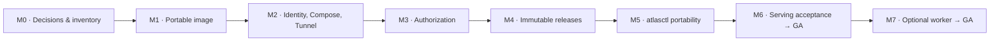
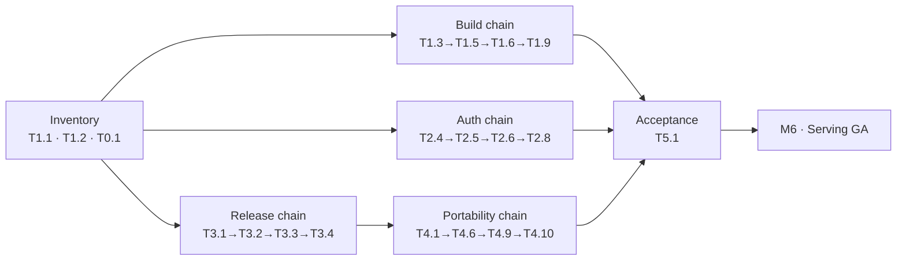

# Fuel Atlas — Dependency-Ordered Roadmap (spec v1.3)

Companion to `ACTION-PLAN.md`. Orders the 46 unitary tasks by dependency and gates them into eight milestones. **Serving release (GA) closes at M6; the optional worker closes at M7.** Tasks are referenced by their `ACTION-PLAN.md` IDs (T0.x–T6.x).

## How to read this

- **Gate** = a milestone is *done* only when its named acceptance criteria pass against the current state. No task in the next milestone starts on an un-gated dependency.
- **Depends on** = the task's hard prerequisites; everything else in the same milestone can run in parallel.
- Four decisions (**FB-D1…FB-D4**) are prerequisite *inputs*, not implementation: resolve them at M0 so no downstream task blocks on an unanswered question.

---

## 1. Milestone overview

| Gate | Name | Exit criteria (acceptance) | Outcome |
|---|---|---|---|
| M0 | Decisions & inventory locked | FB-D1…D4 resolved; route/DB/host inventories recorded | no open ambiguity |
| M1 | Portable image runs | A01, A02, A03, A16 | hardened image builds + starts clean |
| M2 | Identity, Compose & Tunnel | A04, S01, S02, S03, A05 (direct-IP isolation) | app reachable only via its Tunnel |
| M3 | Authorization enforced | A06, A07, A08, A16, A17, S08, S06, A09 | principals/roles/CSRF/audit correct |
| M4 | Immutable releases | A10, A18, A13 | atomic, cache-safe release store |
| M5 | `atlasctl` portability & backup | A11, A12, A15, A19, S05, S07 | install/backup/restore/update proven |
| M6 | Serving acceptance | A01–A19 + S01–S08 all green | **SERVING RELEASE (GA)** |
| M7 | Worker acceptance | W01–W05 | **WORKER RELEASE (GA)** |

---

## 2. Dependency-ordered sequence

| # | Task | Milestone | Depends on |
|---|---|---|---|
| 1 | T1.1 route/server-function inventory | M0 | — |
| 2 | T1.2 DB-usage inventory | M0 | — |
| 3 | T0.1 host inventory | M0 | — |
| 4 | T0.2 installation identity model | M0 | — |
| 5 | FB-D1…D4 resolution | M0 | — |
| 6 | T1.3 `build:portable`/`start:portable` | M1 | T1.1 |
| 7 | T1.4 decouple build from migrations/secrets | M1 | T1.2 |
| 8 | T1.5 multi-stage Dockerfile + `.dockerignore` | M1 | T1.3, T1.4 |
| 9 | T1.6 runtime hardening | M1 | T1.5 |
| 10 | T1.7 health/readiness endpoints | M1 | T1.6 |
| 11 | T1.8 runtime config + env translation | M1 | T1.1 |
| 12 | T1.10 runtime asset packaging | M1 | T1.1 |
| 13 | T1.9 serving-mode safe import | M1 | T1.1, T1.6 |
| 14 | T0.3 host runbook (firewall/SSH) | M2 | T0.1 |
| 15 | T0.4 sibling test application | M2 | T0.1 |
| 16 | T0.5 capacity admission model | M2 | T0.1 |
| 17 | T2.1 Compose network/secret shape | M2 | T1.5, T0.2 |
| 18 | T2.2 named Tunnel + DNS + hostnames | M2 | T2.1 |
| 19 | T2.3 Access apps/policies/consumers | M3 | T2.2 |
| 20 | T2.4 host/route classification | M3 | T1.1 |
| 21 | T2.5 Access JWT verification | M3 | T2.4, T2.3 |
| 22 | T2.6 principal/role + route matrix | M3 | T2.5 |
| 23 | T2.7 `/internal/` isolation | M3 | T1.7, T2.4 |
| 24 | T2.8 GET→POST + CSRF | M3 | T1.1, T2.6 |
| 25 | T2.9 capability-disabled + UI | M3 | T2.6 |
| 26 | T2.10 durable audit logging | M3 | T2.6 |
| 27 | T2.11 bounded diagnostics path | M3 | FB-D1, T1.8 |
| 28 | T3.7 consumer schema/ID/query compatibility | M3 | T1.1 |
| 29 | T4.13 browser state export/import | M3 | T2.4 |
| 30 | T3.1 release envelope/manifest schema | M4 | FB-D2 |
| 31 | T3.2 release validator | M4 | T3.1 |
| 32 | T3.3 atomic publisher | M4 | T3.2 |
| 33 | T3.4 release-identity cache invalidation | M4 | T3.3 |
| 34 | T3.5 remove rebuild-on-read | M4 | T1.9, T3.3 |
| 35 | T3.6 live overlays separation | M4 | T3.3, FB-D4 |
| 36 | T4.1 bundle manifest + `deployment.json` | M5 | T3.1 |
| 37 | T4.2 `atlasctl` CLI skeleton | M5 | T0.2 |
| 38 | T4.12 storage admission checks | M5 | T0.5 |
| 39 | T4.3 `init` | M5 | T4.2 |
| 40 | T4.4 `preflight` | M5 | T0.2 |
| 41 | T4.5 `verify` | M5 | T3.2 |
| 42 | T4.7 `import` | M5 | T4.1, T4.12 |
| 43 | T4.8 `release import`/`activate` | M5 | T3.3, FB-D2 |
| 44 | T4.6 `export` (3 modes) | M5 | T4.1, T4.9 |
| 45 | T4.9 `backup` (encrypted) | M5 | T4.6, FB-D3 |
| 46 | T4.10 `restore` | M5 | T4.9, FB-D3 |
| 47 | T4.11 `update` | M5 | T4.9 |
| 48 | T5.1 acceptance suite A/S | M6 | WP1–WP4 |
| 49 | T5.2 performance/soak benchmark | M6 | T5.1 |
| 50 | T5.3 first-deployment runbook execution | M6 | WP0–WP4 |
| 51 | T5.4 backup/restore drill (RPO/RTO) | M6 | T4.9, T4.10 |
| 52 | T5.5 manifest/SBOM/verification report | M6 | T1.5, T5.1 |
| 53 | T6.1 durable queue/leases/recovery | M7 | T1.2 |
| 54 | T6.2 worker image | M7 | T3.3 |
| 55 | T6.3 singleton scheduler | M7 | T6.1 |
| 56 | T6.4 edit/rebuild/publish transaction | M7 | T3.3, T6.3 |
| 57 | T6.5 feed quota persistence | M7 | T3.6 |
| 58 | T6.6 capability UI (pending/success/failure) | M7 | T2.9, T6.4 |
| 59 | T6.7 worker acceptance W01–W05 | M7 | T6.1–T6.6 |

---

## 3. Critical path & parallel tracks

Three roughly equal chains fan out from inventory and reconverge at acceptance. None dominates the schedule; the longest single serial chain is ~6 tasks.

**Critical path (serving GA):** `T1.1 → T1.3 → T1.5 → T1.6 → T1.9 → T2.4 → T2.5 → T2.6 → T2.8 → T3.1 → T3.2 → T3.3 → T4.1 → T4.6 → T4.9 → T4.10 → T5.1 → T5.3 → M6`

> Note: the chain above is the *union* of the longest parallel dependencies, not a single file-touching sequence — the release, auth and portability chains run concurrently and merge at acceptance. Treat it as "these are the tasks whose late delivery delays GA."

**Keystone tasks (high fan-in — protect them / start early):**
- **T1.1 route inventory** — feeds build, auth, compatibility and safe-import. Everything downstream waits on it.
- **T1.5 Docker image** — gates all Compose, hardening and acceptance work.
- **T3.3 atomic publisher** — gates cache invalidation, `release import`/`activate`, the worker image and the edit transaction.
- **T4.2 CLI skeleton** — gates every `atlasctl` subcommand.
- **T4.9 backup** — gates restore, update and the RPO/RTO drill.
- **T5.1 acceptance suite** — the single convergence point for the entire serving release.

---

## 4. Gate detail (what must be true to pass each milestone)

- **M0 gate** — FB-D1…D4 answered; T1.1/T1.2/T0.1 written down; no route/DB/host ambiguity left to discover mid-build.
- **M1 gate** — `npm ci` + typecheck + build pass (A01); container starts with no source checkout, Vite, Python, Jarvis or systemd (A02); no secrets/migration in the build (A03); `/internal/healthz` + `readyz` respond internally and `/internal/*` is 404 outside the probe source (A16); restart/recreate retains state and the read filesystem is read-only (A09, first half).
- **M2 gate** — rendered Compose has zero ports, no host networking/privileged/socket (A04); distinct explicit project IDs and collision preflight (S01); sibling app unchanged through deploy/update/stop/restore (S02); per-app Tunnel, stopping Atlas ingress leaves the sibling reachable (S03); external IPv4/IPv6 cannot reach origin (A05, isolation half).
- **M3 gate** — invalid/expired/wrong-issuer/wrong-audience JWTs and forged headers fail, read principals can't reach admin routes (A06); no state change via GET/alt-host/SSR/unclassified route, CSRF fails (A07); authenticated queries preserve IDs/filters/units/counts (A08); public hostnames return non-success for `/internal/*` (A16); API-host request with `X-Forwarded-Host` spoof stays on the API route class (A17); real FuelBuddy service auth works and can't mutate (S08); logging saturation stops spooling with no unlimited Docker copy (S06); browser origin import preserves records/counts (A09, second half).
- **M4 gate** — bad/truncated/tampered release fails verification; interrupted promotion never mixes manifest/data; rollback restores the old release (A10); promotion between a manifest fetch and its tiles never returns two releases (A18); expired overlay ignored, missing optional token doesn't break readiness (A13).
- **M5 gate** — clean-host restore from a serving export passes checksums/auth/functional tests with no `/home/remi` dependency (A11); wrong arch/format/unsafe archives fail before activation (A12); no prune/cleanup/expiration in any script (A15); `release import` is idempotent and never touches identity/state/`current`, `init` is idempotent, `kid` refresh behaves as specified (A19); insufficient bytes/inodes/quota reject without data loss (S05); snapshot quiescing/consistency and failed-backup service restoration hold (S07).
- **M6 gate** — A01–A19 and S01–S08 all recorded with evidence in the verification report → **SERVING RELEASE (GA)**.
- **M7 gate** — W01–W05 recorded → **WORKER RELEASE (GA)**; base serving release stays usable with the worker disabled (W04 is a permanent regression guard).

---

## 5. Notes & risks

- **M0 is the highest-leverage early investment.** T1.1 (route inventory) and T1.2 (DB usage) determine whether the schema/route assumptions in §2 hold; a discovery here changes scope downstream. Don't start T1.5 before T1.1 is recorded.
- **FB-D2 blocks the release track and, transitively, portability.** Resolve it first if releases matter more than auth. FB-D1 blocks only the diagnostics path (T2.11), not the serving release.
- **M3 and M4 are independent** once M2 is gated; run authorization and immutable-release work in parallel teams.
- **The deletion rule (§1, §4.0) is a permanent gate**, not a milestone: every T4.x subcommand and every Docker lifecycle change is reviewed for "no auto prune/cleanup/expiration" and "explicit authorization to remove/replace a named item" (A15, S05).
