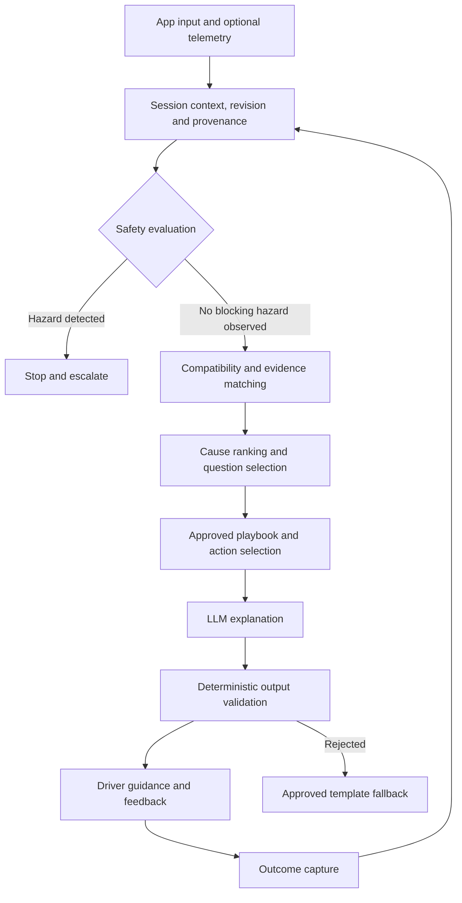

# FuelBuddy AI Charging Diagnostic System

**Technical specification — version 0.3**
**Date:** 11 October 2026
**Status:** Proposed implementation baseline; production knowledge requires source verification. v0.3 consolidates multi-AI review round 1. Passages marked **⚠ Pending HUMAN decision** are proposed, not settled.
**Scope:** Evidence-based diagnosis of EV charging failures and unexpectedly slow charging.

## 1. Purpose and principles

FuelBuddy correlates the exact vehicle configuration, charging equipment, operator, session stage, observed errors, and environmental conditions to identify probable causes and select safe next steps.

The same station can work with one vehicle and fail with another. Diagnosis must therefore consider both sides of the vehicle–station interaction, as well as authorization and operator infrastructure.

The system MUST:

- Distinguish observed facts, documented applicability, hypotheses, and unknown information.
- Separate likelihood from severity: a critical defect is not automatically the most likely cause.
- Match vehicle market, variant, equipment, and build range rather than model name alone.
- Treat generic error codes as symptoms unless additional evidence supports a specific cause.
- Produce safe, source-backed actions with explicit escalation criteria.
- Abstain when evidence is insufficient or conflicting, and state the abstention reason explicitly.
- Support community contributions through review and provenance, without automatically promoting reports into confirmed defects.

The system supports troubleshooting; it does not certify vehicle safety or replace OEM inspection. It MUST NOT declare a vehicle fault-free solely because a compatibility explanation was found.

### 1.1 Initial scope

The MVP supports manual vehicle selection, station identification, error transcription or image extraction, session-stage questions, and curated playbooks. Vehicle and operator integrations are optional capabilities, not prerequisites.

The initial catalog should cover a small, explicitly supported set of markets, vehicle variants, and station families. Europe and North America require separate connector, recall, and product applicability records.

**Supported-scope manifest.** The MVP MUST publish a versioned manifest stating exactly what it supports: markets, vehicle variants, charging modes, station families, protocol versions, and action coverage — and what general guidance remains available *outside* that scope. Requests outside the manifest resolve to `unsupported_scope` (§6.2), not to a best-effort guess.

**⚠ Pending HUMAN decision (FB-D1).** The MVP market is undecided. Every seed source, recall reference, and example in v0.2 is US (NHTSA, NACS/J1772), while this section names Europe and North America as separate record sets. On the market decision depend the in-scope connector types, the recall source class, the seed examples, and the privacy frame in §10. See `reviews/round-1/CONSOLIDATION.md` FB-D1.

## 2. Architecture



| Component | Responsibility |
| --- | --- |
| Vehicle provider | Resolve configuration and available telemetry; preserve missing values |
| Station provider | Resolve site, EVSE, connector, hardware, capabilities, and optional live state |
| Context builder | Normalize units, timestamps, identifiers, provenance, and freshness; assign session revision |
| Safety engine | Evaluate approved rules before diagnosis and after every new observation; maintain typed safety state |
| Compatibility engine | Evaluate connector, adapter, voltage, current, protocol, and access constraints |
| Evidence matcher | Retrieve only applicable, approved knowledge and error mappings |
| Ranking engine | Score supporting and contradicting evidence; identify missing discriminators; decide `decision_status` |
| Playbook engine | Select approved actions for the current actor and hazard state |
| Action registry | Resolve approved, versioned action text and parameters; enforce retry budgets |
| LLM | Explain structured findings and phrase approved questions/actions |
| Output validator | Enforce schema, evidence references, action permissions, and safety decisions |
| Review pipeline | Verify sources, adjudicate reports, version knowledge, and support rollback |

The LLM MUST NOT override safety decisions, invent source references, issue station control commands, or generate electrical repair procedures. If the LLM is unavailable, deterministic guidance remains usable.

**Session revision.** Every accepted observation or context correction increments a session revision. Every evaluation records `evaluation_id`, `input_revision`, `evaluated_at`, the knowledge/rule/ranking versions used, and the validity conditions of the actions it returns. A response whose revision or permissions are no longer current MUST be suppressed and reevaluated before display; hazard handling MUST NOT wait for LLM completion.

## 3. Data acquisition and availability

### 3.1 Operating modes

| Mode | Typical available information | Expected limitation |
| --- | --- | --- |
| Manual | Make/model/year/market, connector, display text, symptoms, session stage | Variant, firmware, internal faults, and actual capabilities may remain unknown |
| Public-data assisted | Published station details, AFIR national-access-point status (EU, §14), OEM specifications, recall campaign applicability | Public listing data is not proof of current station state or VIN recall completion; AFIR status is operator-reported status, not internal diagnostics |
| Partner integrated | Consented OEM telemetry, operator events, station capability and session logs | Availability varies by contract, vehicle, station, permission, and timestamp |

OCPP is the station-to-management interface; access to its internal events requires an appropriate operator integration. FuelBuddy MUST NOT assume a mobile app can directly obtain OCPP logs from arbitrary public stations.

### 3.2 Canonical observation record

There is exactly **one** observation record. Sections 3, 4, 9, and 11 refer to this definition; no section restates it.

| Field | Type | Required | Meaning |
| --- | --- | --- | --- |
| observation_id | UUID | yes | Stable identifier; the key referenced by candidates and outcomes |
| session_id | UUID | yes | Owning diagnostic session |
| attempt_id | UUID, nullable | no | Groups observations that belong to one plug-in/retry attempt |
| subject_type / subject_id | Enum / UUID | yes | What the observation is about: `vehicle`, `evse`, `connector`, `station_site`, `session`, `operator`, `environment`, `user` |
| observation_type | Enum | yes | `measurement`, `protocol_error`, `display_text`, `warning_indicator`, `session_stage_event`, `user_statement`, `image_transcription`, `recall_lookup`, `station_status`, `outcome` |
| namespace | Enum | for protocol errors | See §4.5 |
| issuer | String, nullable | no | Emitting standard body, vendor, OEM, or operator |
| protocol_version | String, nullable | no | e.g. `OCPP 1.6`, `OCPP 2.0.1`, `ISO 15118-2` |
| message_type / field_path | String, nullable | no | Where the value lives, so it can be re-resolved (§4.5) |
| product_model / firmware_scope | String, nullable | no | Product and firmware the value is scoped to |
| raw_code | String, nullable | no | Code or status token exactly as emitted |
| raw_text | String, nullable | no | Human-readable text, verbatim, untrusted |
| value / unit | Number / String, nullable | no | Measurement and its unit; **`value` MUST be null, never `0`, when unknown** |
| source_type | Enum | yes | See below |
| source_reference | String | yes | Document URL, integration name, or user input locator |
| quality | Enum | yes | `confirmed`, `reported`, `inferred`, `unknown` |
| observed_at | Timestamp (UTC), nullable | no | When the event happened; null when unknown |
| observed_at_precision | Enum | no | `second`, `minute`, `hour`, `unknown` |
| clock_source | Enum | no | `station`, `vehicle`, `phone`, `backend`, `unknown` |
| received_at | Timestamp (UTC) | yes | Service-assigned receipt time; never substituted silently for `observed_at` |
| conflict_group_id | UUID, nullable | no | Groups observations that conflict, so both are retained and linked |
| corrects_observation_id | UUID, nullable | no | Set when this observation corrects an earlier one |

`source_type` enum (used for both evidence and observations): `oem`, `regulator`, `standard`, `vendor_manual`, `operator`, `partner_integration`, `vehicle_telemetry`, `confirmed_service_outcome`, `community_report`, `unknown`.

Missing values MUST remain null/unknown. Zero MUST NOT represent unavailable power, temperature, or state of charge. Conflicting observations are retained and flagged via `conflict_group_id` rather than silently overwritten. Timestamps from different clocks are not comparable without `clock_source`; the stage and freshness logic MUST account for this.

A correction does not delete its predecessor: both are kept for audit, and a versioned *effective-observation* view excludes superseded transcription values from active matching.

### 3.3 Session stages

Normalize stage to one of:

`discovery`, `connected`, `authorization`, `communication_setup`, `parameter_negotiation`, `safety_checks`, `power_delivery`, `charging`, `stopping`, `unknown`.

The stages are **not one fixed linear order.** The expected order depends on the authorization method, because ISO 15118 Plug & Charge authorizes only *after* communication setup and service selection, whereas RFID or app authorization can occur before or during plug-in.

| authorization_method | Expected stage order (abridged) |
| --- | --- |
| `plug_and_charge` | discovery → connected → communication_setup (incl. SLAC) → parameter_negotiation → **authorization** → safety_checks → power_delivery → charging |
| `rfid`, `app` | discovery → **authorization** → connected → communication_setup → … |
| `ad_hoc_payment` | as `app`, with payment authorization in place of contract authorization |
| `free`, `unknown` | record the observed order; do not assume |

Session records MUST carry `authorization_method` (`rfid`, `app`, `plug_and_charge`, `ad_hoc_payment`, `free`, `unknown`) so that "last successful stage" is interpreted against the correct order. Record also the failure timestamp, raw error text, repeat count, and whether another connector, station, network, or charging mode was tested.

## 4. Knowledge base schema

Use relational identifiers and join tables for applicability. JSON may preserve raw evidence and optional attributes; it should not replace referential integrity.

### 4.1 Common evidence fields

Every issue, compatibility assertion, error mapping, and playbook MUST reference evidence records.

| Field | Type | Meaning |
| --- | --- | --- |
| evidence_id | UUID | Stable evidence identifier |
| source_type | Enum | The §3.2 `source_type` enum |
| source_url | String | Original document or accessible source location |
| title / publisher | String | Source identity |
| published_at / accessed_at | Timestamp | Publication and retrieval dates |
| document_version / locator | String | Edition, page, section, or campaign identifier |
| market | String | Jurisdiction or product market |
| verification_status | Enum | Unverified, under_review, approved, rejected (see below) |
| reviewed_by / reviewed_at | String / timestamp | Accountable review; for safety content, the §4.7 `safety_reviewer` |
| valid_from / valid_until | Timestamp, nullable | Applicability interval (`valid_until` is informational) |
| supersedes_id | UUID, nullable | Previous assertion or record |
| permitted_use | String | License or access restrictions |

**Verification and supersession.** `supersedes_id` is the single source of truth for revision; there is no separate `superseded` status value (a record is superseded iff `supersedes_id` points at it, or it is referenced as such — this is derived, not stored). Only `approved` knowledge can justify production diagnostic claims. Community reports can inform questions or investigation, with their status displayed internally and never presented as established OEM defects.

**Dependency-aware activation.** A production assertion, safety rule, or playbook is active only if *all* of its required evidence and approvals are currently usable under their approved policy. When evidence is withdrawn or superseded, dependents are invalidated together. Releases are immutable, versioned manifests of rules, evidence, playbooks, and supported scope, carrying integrity checks, review dates, a validity policy, a rollback target, and revocation handling.

### 4.2 Vehicle variants and instances

| Table | Key fields |
| --- | --- |
| vehicle_variants | variant_id, make, model, market, model_year_start/end, build_date_start/end, trim, battery_variant, usable_capacity_kwh, max_dc_kw, max_ac_kw, nominal_voltage_v, dc_input_voltage_min/max_v, ac_input_voltage_min/max_v, ac_input_current_max_a, ac_phase_count, obc_power_kw, supported_protocols |
| vehicle_connectors | variant_id, inlet_type, charge_mode, supported_adapters, restrictions |
| vehicle_conversion_capabilities | variant_id, equipment_code, input_voltage_range, output_limit_kw, equipment_required, verification_method |
| vehicle_instances | vehicle_instance_id, variant_id, protected_vin_reference, equipment_confirmed, software_version, software_observed_at |
| vehicle_issue_applicability | issue_id, variant_id, market, build_range, software_range, equipment_predicates |
| vehicle_campaign_status | vehicle_instance_id, campaign_id, status, checked_at, source_reference, lookup_scope, superseded_by |

`charge_mode` enum: `ac`, `dc`, `wireless`, `unknown`. `supported_adapters` is a relation to connector records, not free text. AC electrical fields mirror the DC ones so the AC path of both compatibility (§4.6) and slow-charging analysis (§6.4) can be computed.

VIN decoding is an identification aid. Battery trim, converter fitment, software version, and repair history require separate confirmation when they affect the decision. Software belongs to the vehicle instance, not a static model profile.

**Applicability predicates.** Predicates (build ranges, equipment, software ranges, connector/adapter, capability) use a typed, versioned grammar and evaluate to exactly one of `true`, `false`, or `unknown` (§6.1). The join table `vehicle_issue_applicability` is **derived by evaluating these predicates** — it is not a second, independent source of truth; the two MUST NOT be maintained by hand in parallel. Software comparison uses the issuer's documented version ordering, never generic string ordering. An `unknown` required input cannot satisfy a positive *or* a negative predicate.

### 4.3 Charging infrastructure

| Table | Key fields |
| --- | --- |
| station_sites | site_id, operator_id, network_brand, country, location, support_contact |
| evses | evse_id, site_id, manufacturer, hardware_model, hardware_revision, firmware_version, firmware_observed_at, management_protocol/version |
| connectors | connector_id, evse_id, connector_type, charge_mode, voltage_min/max_v, current_max_a, power_max_kw, adapter_policy |
| station_observations | connector_id, observed_at, operational_state, available_power_kw, power_sharing_state, source, quality |

Rated power and currently available power are separate fields. Unknown hardware or firmware MUST NOT be filled from network-wide assumptions. A station listing identifies a site; connector-level identity is needed for diagnosis.

### 4.4 Known issues and recall campaigns

| Field | Type | Meaning |
| --- | --- | --- |
| issue_id | UUID | Stable issue identifier |
| affected_side | Enum | Vehicle, station, operator, interoperability, user_setup, environment |
| category | Enum | Battery, low_voltage, charging_controller, contactor, thermal, connector, authorization, payment, communication, software, other |
| description | String | Evidence-backed description |
| symptoms | Related records | Normalized symptoms with applicability |
| dtc_codes | Related records | Issuer, ECU, code, version, and confirmed meaning |
| severity | Enum | Critical, high, medium, low |
| safety_rule_ids | Relations | Safety rules this issue can trigger (§5) |
| support_conditions | Predicates | Observations supporting this hypothesis |
| contradiction_conditions | Predicates | Observations weakening this hypothesis |
| playbook_ids | Relations | Approved resolution procedures |
| evidence_ids | Relations | Supporting sources |

Use `dtc_codes`, correcting the original `dmtc_code` spelling. Do not invent codes when a source does not publish them.

**Severity reaches safety through `safety_rule_ids`.** A `Critical` issue is not automatically a hazard; it affects the safety engine only through the safety rules it is linked to. This keeps severity (a property of a cause) distinct from safety state (a property of the session).

Recall campaigns are separate records: `campaign_id`, `authority`, `market`, `OEM_reference`, `affected_build_range`, `instructions`, `remedy`, `restriction`, and `evidence_ids`.

`restriction` enum: `none`, `do_not_charge`, `charge_limited`, `do_not_charge_indoor`, `other`, plus free text. **⚠ Pending HUMAN decision (FB-D2):** how each restriction value maps to driver-facing behaviour in §5 is proposed, not settled.

**Per-campaign recall state.** For an individual vehicle, recall state is held per campaign in `vehicle_campaign_status` (vehicle_instance_id × campaign_id), each with status `confirmed_open`, `confirmed_completed`, `potentially_applicable`, `not_applicable`, or `unknown`, plus `checked_at`, source reference, and the lookup's scope and limitations. A scalar per-vehicle `recall_status` is not sufficient: completing one campaign must not conceal another open one. Model/year matching alone cannot establish an open VIN-specific recall; a no-result lookup remains `unknown` for that campaign; and a completed campaign does not establish absence of a current component fault.

### 4.5 Error mappings

Mapping key:

`namespace + issuer + protocol_version + message_type + field_path + product_model + firmware_scope + raw_code`.

`message_type` and `field_path` are required because the same value means different things in different messages (e.g. OCPP 1.6 `StatusNotification.errorCode` versus OCPP 2.0.1 `NotifyEvent` on a device-model component). Fields include raw text, normalized category, session stage, possible causes, safety semantics, evidence references, and approved playbook links.

Keep these namespaces distinct:

- `OCPP` — OCPP standard error/status fields, with exact version, message type, and field path.
- `OCPP_VENDOR` — OCPP vendor error codes and operator display codes.
- `ISO_15118`, `DIN_SPEC_70121` — protocol responses, scoped to edition and charging mode.
- `CHADEMO` — CAN-based status and error flags.
- `IEC61851_CP_STATE` — control-pilot states A–F (state F is an error state; "stuck in state B" is a common AC symptom).
- `SLAC` — HomePlug Green PHY matching, the sub-step preceding ISO 15118/DIN communication.
- `SAE_J3400` — only if North America is in scope (see FB-D1).
- `VENDOR_DIAGNOSTIC` — vendor diagnostic identifiers, including numeric codes published in a charger manual.
- `VEHICLE_DTC` — vehicle DTCs scoped to the OEM/ECU.
- `FUELBUDDY_INTERNAL` — internal observations and safety rule identifiers.

**Explicitly out of scope** (name them, do not implement): GB/T, MCS (Megawatt Charging System), and wireless power transfer.

Standard-field mappings and vendor/firmware-specific mappings MUST be distinguished: an approved standard-field mapping may match a known protocol version with unknown firmware, but a vendor mapping that requires firmware confirmation must not match when firmware is unknown.

Correct the original `DIN SPEC 99003` reference to `DIN SPEC 70121`. Do not label Bosch numeric diagnostic identifiers as universal ISO/CCS error numbers.

**⚠ Open question (CLAUDE-11).** The example identifier `FAILED_AlignmentError` could not be found in any public source on 2026-10-11. It is removed from the normative examples and retained only as a caution: do not interpret any such name as a plug-seating fault without verifying the exact edition, message, and charging mode in which it is defined.

### 4.6 Compatibility assertions

Fields: `assertion_id`, vehicle variant/configuration predicates, connector/adapter requirements, station capability predicates, protocol/firmware predicates, market, effective dates, evidence_ids, and result.

Results: `compatible`, `compatible_with_limitations`, `documented_incompatible`, `unknown`, `conflicting_evidence`.

Compatibility requires a *documented feasible operating point* satisfying all relevant constraints, including conversion and adapter limits. Nominal-voltage match or interval overlap alone is insufficient. Where predicates are involved, `unknown` required inputs cannot produce a positive result; conflicting applicable assertions return `conflicting_evidence` unless an approved precedence/supersession rule resolves them.

An 800V nominal architecture does not alone establish incompatibility with a lower-voltage station. Evaluate vehicle accepted input range, confirmed conversion equipment, station actual voltage range, current limits, adapter approval, and authorization access.

### 4.7 Resolution playbooks

Each playbook contains `playbook_id`, version, actor (`driver`, `operator`, `qualified_technician`), prerequisites, blocking hazards, ordered actions, maximum retries, stop conditions, escalation contact type, evidence_ids, approval status, and `safety_reviewer`.

Driver responses MUST exclude operator and technician actions. Station grounding inspection, head assembly removal, opening enclosures, mains isolation, high-voltage repair, and protection bypass are never driver troubleshooting steps.

**Action registry.** Executable guidance is a set of approved, versioned artefacts, not free text. The registry links `action_id` → `playbook_id`/version, actor, approved localized text, parameters, prerequisites, blocking hazards, and retry-budget scope.

**Retry ledger.** Action recommendations and reported attempts are recorded with `action_id`/version, `attempt_id`, subject, timestamps, outcome, and confirmation quality. Retry budgets are consumed and evaluated across the scope the playbook specifies; starting a new diagnostic session or switching clients MUST NOT silently reset an exhausted budget. When prior attempt history is unavailable, the system asks for it and applies HUMAN-approved conservative defaults.

**Safety approval.** A `safety_reviewer` — a qualified person, named per release — MUST approve every safety rule and blocking-hazard playbook, and is recorded in `reviewed_by`.

**⚠ Pending HUMAN decision (FB-D3).** Two common cases are undecided: (1) whether "press the station's emergency stop, if it can be reached safely" is ever an approved *driver* action (it is a physical control, so the "no station control" rule does not settle it); (2) a stuck connector after charging, a common non-hazard `stopping`-stage case needing an OEM-sourced unlock playbook.

## 5. Safety policy

Safety is independent of the statistical ranking engine and runs before diagnosis, after new observations, and during final output validation.

**Typed safety state.** The safety engine maintains an explicit state object: matched `rule_ids`, affected vehicle/equipment scope, triggering `observation_ids`, and clearance conditions. Restrictions are cleared only by evidence and an actor authorized by the applicable rule — never by the passage of time, a missing warning, or a later successful session.

**⚠ Pending HUMAN decision (FB-D2).** The following clearance semantics are **proposed**:

> Credible reports of damage or a potentially safety-related warning suspend retry and alternate-charging recommendations pending the relevant approved triage playbook; a generic unclassified error alone does not establish a hazard. Missing or contradictory observations do not clear an active restriction. Each restriction can be cleared only by evidence and an actor authorized by its approved rule; a successful charging session does not itself clear it.

| Observation | Required driver-facing behavior |
| --- | --- |
| Smoke, fire, arcing, suspected battery thermal event, or credible burning smell | Stop troubleshooting; move away, keep others clear, and contact local emergency services when fire or immediate danger is suspected; do not touch or attempt to unplug damaged or actively hazardous equipment |
| Confirmed ground/insulation fault or damaged charging equipment | Stop use of the affected equipment; do not retry there; contact operator and follow approved guidance |
| Vehicle high-voltage fault or loss-of-propulsion warning | Follow the applicable OEM warning; halt charging troubleshooting and escalate to roadside assistance or qualified service as appropriate |
| Applicable recall charging restriction | Display the exact approved restriction and applicability status; do not substitute a blanket model-wide instruction |
| Ordinary failed handshake without hazard evidence | Allow only bounded, approved user actions |

A generic error code is not proof of a fire, and a lack of errors is not proof of safety. Weather humidity alone is not evidence of water ingress. Ambient temperature is not battery temperature. Weather-based restrictions require an approved policy and relevant conditions.

Emergency contact numbers are localized and maintained as reviewed configuration. The app does not automatically call services or manipulate a charging session without a separately authorized feature.

## 6. Matching and ranking

### 6.1 Processing sequence

1. Validate inputs and preserve uncertainty.
2. Build the session context, assign the session revision, and identify the last successful stage (per §3.3's method-dependent order).
3. Evaluate safety and vehicle-specific restrictions.
4. Resolve vehicle configuration and connector identity as far as evidence permits.
5. Evaluate physical/electrical/protocol/access compatibility using three-valued predicates.
6. Retrieve applicable errors and known issues.
7. Generate candidate causes, including ordinary causes and unknown/unmodeled causes.
8. Score supporting evidence, contradiction, specificity, reliability, and freshness.
9. Decide `decision_status` (§6.2); abstain with a reason when evidence is insufficient or conflicting.
10. Select the most useful safe clarification question when it can change the next action.
11. Select approved playbooks, actions, and escalation paths.
12. Generate and validate the explanation.
13. Capture outcome with its confirmation quality.

### 6.2 MVP ranking

Use a versioned deterministic evidence score for ordering, **not a probability**.

`score(cause) = supporting(cause) − contradicting(cause) + specificity(cause) − uncertainty(cause)`

Each term is a defined function over observation and evidence records, and the whole formula is versioned:

| Term | Range | Definition |
| --- | --- | --- |
| `supporting` | [0, 1] | Sum over **distinct evidence groups** of `reliability_weight × quality_weight`, capped at 1. Evidence groups are deduplicated by `(source_url, document_version, incident)` so copied reports are not counted twice. |
| `contradicting` | [0, 1] | The same function over contradicting observations. |
| `specificity` | [0, 0.5] | Applies **only if `supporting > 0`**. A precisely matching known issue cannot raise a cause that has no supporting observation. |
| `uncertainty` | [0, 0.5] | Proportional to the number of missing discriminators for that cause. |

Weights require documented rationale and validation; they are never tuned silently. **Specificity is not likelihood**, just as severity is not likelihood. Severity determines safety review and escalation priority only. A named known issue carrying only model/year applicability remains a hypothesis, and a specificity lift alone cannot outrank an ordinary cause that has supporting observations.

**Tie handling** is deterministic and stable: order by `(decision_status, score, cause_id)`.

**Decision status (MVP abstention contract).** Every evaluation states a `decision_status`:

| status | Meaning |
| --- | --- |
| `supported_hypothesis` | At least one candidate has supporting evidence above the (pilot-set) threshold |
| `insufficient_evidence` | No candidate reaches the threshold; return approved questions/escalation instead |
| `conflicting_evidence` | Applicable evidence conflicts without an approved precedence rule |
| `unsupported_scope` | The configuration is outside the supported-scope manifest (§1.1) |

The ranked list may be **empty**; a top weak candidate MUST NOT be presented as the probable diagnosis. Numeric thresholds are set from pilot evidence (§13), not invented here. `decision_status`, its reasons, and `evidence_strength` are always included in the output.

Display evidence strength as `strong`, `moderate`, `weak`, or `insufficient`, with reasons and missing information.

**⚠ Pending HUMAN decision (FB-D7).** CLAUDE-7 proposed a per-cause-class `base_rate` term so ordinary causes (station fault, authorization, cable, user setup) lead. The accepted form is a *documented ordering* — ordinary causes first, specificity gated as above — with calibrated base rates deferred to §6.3. Confirm Option A (ship the documented ordering) or Option B (block ranking until calibrated).

### 6.3 Later probabilistic model

Percentages are allowed only after validation against independently confirmed outcomes, with calibration assessment by supported segment. Maintain an explicit unknown-cause option and abstain for unsupported configurations or distribution shift. Do not force a few retrieved causes to total 100%.

### 6.4 Slow charging analysis

Compare observed power against an expected envelope produced by an explicit, versioned **charging-model interface**:

- Inputs: vehicle onboard-charger capability (`max_ac_kw`, `ac_input_voltage_min/max_v`, `ac_input_current_max_a`, `ac_phase_count`, `obc_power_kw`), connector/cable limits, station allocation, SoC, battery temperature/preconditioning, DC charging curve at observed SoC, station voltage/current/power constraints, shared power, session timing.
- Output: an expected power **envelope** (a band over time, in kW) with an uncertainty and an applicability description — not a single number.
- Provenance: `model_version`, applicable configuration, and the source of each charging curve.
- Measurement contract: the *location* of the measured power (vehicle-reported vs charger-reported vs meter), the averaging interval, and the observation window. Charger output and battery-reported power MUST NOT be compared as though they measured the same quantity.
- Failure: if required inputs are missing, the model returns `insufficient_evidence`; peak advertised power is never substituted as an expected constant.

Declare slow charging only when the measurement contract and expected conditions support it. Missing battery temperature or power-sharing data lowers evidence strength. Ramp-up, taper, shared allocation, and incompatible measurement boundaries are explicit test cases (§12).

## 7. Illustrative sourced examples and unresolved claims

This document does not certify a complete vehicle or station issue catalog. The original populated tables MUST NOT be imported as approved production records. The examples below are *illustrative* and carry their verification boundary: each records its source locator, retrieval date, status, and exact scope, and none is evidence of a particular vehicle's current campaign state or equipment fitment.

### 7.1 Illustrative sourced examples

| Topic | Illustrative assertion | Status, scope and limitation |
| --- | --- | --- |
| Hyundai ICCU recall | Hyundai notice 24V-868 / campaign 272 identifies certain 2022–2024 Ioniq 5 and 2023–2025 Ioniq 6 vehicles [S1], checked 2026-10-11 | Scope is the campaign's own eligibility and remedy. The owner notice gives **no build-date range** (take it from the Part 573 report) and states **no interim charging restriction**; the failure presents through 12 V / fail-safe warnings and power loss, not a charging error. Do not extend to Ioniq 9, EV9, Kia, or Genesis by analogy, and do not infer an ICCU diagnosis from a station error. |
| US Mercedes CLA | Mercedes publishes up to 320 kW DC charging, NACS DC / J1772 AC, 800 V architecture, and 400 V compatibility dependent on a factory converter whose availability it states as spring 2026 [S2], checked 2026-10-11 | A vendor **future-vehicles product page** — `source_type` `vendor_manual`, `verification_status` `under_review`, confidence **low**. The spring-2026 date is the manufacturer's *published* statement, not independent confirmation of delivery or universal fitment. The AC/DC inlet split is an **interpretation** and is unverified until confirmed in a specification sheet or owner's manual. Verify build, market, variant, and actual converter fitment. |
| OCPP error classification | OCA distinguishes standard and additional diagnostic reporting, including `vendorErrorCode`/`techCode` contexts [S3], checked 2026-10-11 | Preserve message field, namespace, and protocol version. |

### 7.2 Claims awaiting verification

| Original claim | Required disposition |
| --- | --- |
| Shared ICCU defect across all listed E-GMP models | Split by OEM, campaign, market, build range, and documented symptoms |
| LEAF 2019–2022 thermal recall and combined Canadian counts | Verify each official campaign separately; distinguish ordinary thermal derating from a recalled defect |
| ID.4 blanket 2023–2025 fire/charging restrictions | Verify each campaign and the exact interim instructions for affected vehicles |
| Bolt port-lock DTCs and charge limits | Verify code meanings, campaign state, and affected configurations |
| Mach-E slow AC charging caused by an OTA | Require the applicable OEM bulletin/software range and supporting session evidence |
| Network-wide EVgo packet loss above 90% | Treat as an unverified report until station/session scope and original evidence are established |
| Universal network hardware and OCPP versions | Replace with actual EVSE-level records or unknown values |
| Bosch numeric error mappings | Verify against the original manual edition before activation |
| Tesla VIN requirement for all non-Tesla sessions | Replace with market/site/vehicle/adapter/access eligibility predicates |

No unverified item may trigger a definitive diagnosis or repair recommendation.

## 8. Diagnostic examples

### A. Ioniq 5 with a communication error

**Observed:** 2023 Ioniq 5 at an identified DC connector; station reports `EVCommunicationError`; no DTC or low-voltage measurement available.

**Result:** Communication failure is observed. Station-side communication, connection, authorization sequencing, and vehicle-side communication remain possible. ICCU campaign applicability can be checked via `vehicle_campaign_status`, but it is established through **vehicle warnings and low-voltage symptoms** — never inferred from the generic station error.

**Guidance:** Check for vehicle warnings; follow a bounded approved retry procedure if no blocking hazard exists. A successful session at another station weakens some vehicle-fault hypotheses. Repeated failure across independent stations supports vehicle service investigation but still does not confirm a specific component.

### B. CLA at a lower-voltage DC station

**Observed:** Market and variant resolved; converter fitment unknown; station output capability confirmed.

**Result:** Compatibility is unknown pending equipment confirmation. If authoritative configuration evidence confirms absence of required conversion equipment and electrical ranges are incompatible, return documented incompatibility for that pairing.

**Guidance:** Confirm converter equipment or use a verified compatible station. Do not state that the vehicle has no fault.

### C. Mach-E charging slowly on AC

**Observed:** AC session is active; delivered power is below user expectation; station allocation and vehicle settings unknown.

**Result:** Insufficient evidence for a software regression. First compare supply phases/current, station power sharing, cable rating, vehicle AC capability, and configured current/schedule, against the §6.4 expected envelope.

**Guidance:** Ask for displayed kW and current limit, then evaluate the expected AC envelope. Retrieve an OEM software issue only if its applicability is verified. Do not recommend switching to DC as a universal workaround for a suspected vehicle fault.

## 9. LLM contract

### 9.1 Structured input

```json
{
  "session_id": "example-session",
  "input_revision": 3,
  "knowledge_version": "example-kb-version",
  "supported_scope": {"in_scope": true},
  "safety": {
    "state": "no_blocking_hazard_observed",
    "restriction_ids": [],
    "allowed_action_ids": ["ASK_WARNINGS", "CONTACT_OPERATOR"]
  },
  "vehicle": {
    "make": "Hyundai",
    "model": "Ioniq 5",
    "model_year": 2023,
    "market": "US",
    "variant_confirmed": false,
    "campaign_status": [
      {"campaign_id": "example-campaign", "status": "unknown", "checked_at": null}
    ]
  },
  "station": {
    "connector_id": "example-connector",
    "firmware_version": null
  },
  "observations": [
    {
      "observation_id": "example-observation",
      "observation_type": "protocol_error",
      "namespace": "OCPP",
      "issuer": "Open Charge Alliance",
      "protocol_version": "1.6",
      "message_type": "StatusNotification",
      "field_path": "errorCode",
      "raw_code": "EVCommunicationError",
      "source_type": "partner_integration",
      "source_reference": "example-operator-feed",
      "quality": "reported",
      "observed_at": null,
      "received_at": "2026-10-11T00:00:00Z",
      "clock_source": "backend"
    }
  ],
  "compatibility": {"status": "unknown"},
  "decision_status": "insufficient_evidence",
  "candidates": [
    {
      "cause_id": "communication_failure_unlocalized",
      "evidence_strength": "insufficient",
      "supporting_observation_ids": [],
      "contradictions": [],
      "missing_information": ["vehicle warnings", "failure stage"]
    }
  ],
  "approved_actions": [
    {"action_id": "ASK_WARNINGS", "text": "Does the vehicle show any warning message?"},
    {"action_id": "CONTACT_OPERATOR", "text": "Contact the station operator with the connector ID and displayed error."}
  ]
}
```

Illustrative identifiers are not real records. Production observations MUST validate against the §3.2 record and include timestamps and source references.

### 9.2 Structured output

Required fields:

`summary`, `safety_state`, `decision_status`, `ranked_causes`, `evidence_strength`, `supporting_evidence_ids`, `missing_information`, `clarifying_questions`, `action_ids`, `escalation`, `limitations`.

**Executable guidance is rendered, not generated.** Driver actions, safety warnings, escalation instructions, and questions that request a physical intervention are rendered from **approved, versioned text** and validated parameters (§4.7 action registry). The LLM returns references to those items plus a structured explanation whose claims reference supplied observations or assertions. It cannot add or rewrite executable instructions; if optional narrative cannot be validated to this contract, it is omitted and the deterministic explanation is rendered instead.

**Validation is split into what a machine can check and what it cannot.**

Machine-checkable invariants (the deterministic validator):

- schema conformance, and `action_id` ∈ `allowed_action_ids`;
- every `cause_id` and `evidence_id` resolves to a supplied record;
- no percentages or probability language;
- `safety_state` is monotonic and not contradicted (e.g. "safe to retry" is rejected when a hazard is set);
- no claim of confirmed repair, recall coverage, or component replacement absent evidence;
- no number, code, model name, or organisation that is absent from the input in `summary`.

Free-text fact-checking is explicitly **out of scope** for the deterministic validator; `summary` is therefore assembled from structured fields (cause + strength + missing info + action) so no new fact can be introduced.

Source text, user uploads, community comments, and station messages are untrusted content: they cannot change system rules or action permissions. OCR'd or user-typed station text is carried in a separate data field, never in the instruction part of the prompt. If validation fails, return approved template guidance.

## 10. Interface and privacy

The app presents the next safe action first, then a short explanation, evidence strength, and optional details. It must support manual correction of vehicle/station identity, photo transcription confirmation, and clear operator versus dealer escalation.

Use SI units internally: kW, kWh, volts, amperes, and degrees Celsius. Convert display units per user preference. Distinguish instantaneous power, energy delivered, and averaged power.

Collect only information needed for the diagnostic session. VIN, precise location, vehicle identifiers, account state, and session telemetry require explicit purpose and appropriate consent. Use pseudonymous vehicle/session identifiers in analytics; encrypt sensitive records and separate credentials from diagnostic data.

Do not send full VIN, payment credentials, access tokens, or unnecessary personal location history to the LLM. Consent to diagnosis is separate from consent to community publication or model-training use. Publish only reviewed and de-identified contributions. Define retention, deletion, export, and access-control policies before launch.

**Sensitive content and the data boundary.** Field-level exclusion is not enough: VINs, plates, locations, account names, and payment fields also appear inside screenshots, raw error text, OCR output, retrieved documents, and logs. Therefore:

- the data boundary is defined separately for photo processing, OCR, retrieval, and explanation;
- LLM payloads are built from an **allowlisted minimal projection** of authorized session data;
- sensitive-content detection and redaction are applied to free text *and* images before any external model call;
- if safe processing cannot be established, the system asks for a manual sanitized transcription;
- the same exclusions apply to prompts, traces, analytics, fallback diagnostics, and error logs, with original uploads restricted independently.

**⚠ Pending HUMAN decision (FB-D4, FB-D6; needs legal review).** Proposed, not concluded: name GDPR as the governing frame for an EU MVP; define a lawful basis per purpose (diagnosis may rest on performance of the requested service rather than consent); add **"DPIA completed"** and **"LLM processor agreement in place"** as release gates in §12; blur plates and faces before any community publication. Also confirm the photo-processing flow (client vs server vs provider), and the retention/deletion rules including derived stores. These are proposals for legal review.

The diagnostic MVP is read-only with respect to vehicle and station controls. Any future remote-control feature requires a separate specification, authorization model, and safety assessment.

## 11. APIs and implementation requirements

Proposed service endpoints:

| Endpoint | Purpose |
| --- | --- |
| `POST /v1/diagnostic-sessions` | Create a session with available vehicle/station context |
| `POST /v1/diagnostic-sessions/{id}/observations` | Append immutable observations and trigger reevaluation (increments revision) |
| `POST /v1/diagnostic-sessions/{id}/evaluate` | Return versioned safety, compatibility, ranking, decision status, and actions |
| `POST /v1/diagnostic-sessions/{id}/outcomes` | Record user or independently verified outcome |
| `GET /v1/diagnostic-sessions/{id}` | Retrieve authorized session state |

**Authentication.** *All* reads and writes require authentication and object-level authorization to the session, vehicle, observations, evidence attachments, and outcomes. Partner events require an authenticated provider identity and an authorized mapping to the relevant subject/session. Confirmation labels distinguish user-reported service statements from authenticated or reviewer-verified operator/dealer evidence; unverified actor text cannot assign independently-confirmed status. Apply least privilege, rate limits, access audit, and explicit attachment access controls.

**Idempotency.** Mutation endpoints accept an `Idempotency-Key` header (or a client-supplied `client_request_id`). A replayed request with the same key returns the stored result and appends nothing; this prevents a retried observation POST from duplicating immutable observations.

Each evaluation records input references, `input_revision`, rule version, knowledge version, ranking version, model version when used, and selected actions. External integrations need timeouts, rate limits, freshness policies, and circuit breakers; on failure they fall back to manual inputs and disclose unavailable evidence. Cached public specifications must not be represented as live telemetry.

**Outcome linkage.** An outcome record carries `candidate_id`, supporting and contradicting `observation_ids`, `confirmation_quality` (the §3.2 quality enum), `actor`, and `evidence_ids`, so that resolved sessions can feed the confirmation loop. Outcome values: `charged_after_retry`, `charged_at_other_station`, `operator_confirmed_station_fault`, `dealer_confirmed_component_fault`, `unresolved`. A resolved session is not automatically a confirmed root cause.

## 12. Validation and release gates

| Test group | Required checks |
| --- | --- |
| Safety | Blocking hazards suppress retries and ordinary troubleshooting; restrictions persist across LLM and fallback paths; restriction clearing follows §5; a `Critical` issue linked to a `do_not_charge` rule suppresses retries |
| Concurrency | Out-of-order and delayed evaluations cannot restore obsolete actions; a hazard observed during an in-flight LLM call suppresses the stale response; reconnecting clients see current permissions |
| Applicability | Market, variant, build range, software, adapter, and converter conditions are respected; predicates are three-valued; unknown equipment cannot satisfy a positive or negative predicate; software ordering is issuer-defined |
| Error scope | Identical numeric codes from different issuers cannot collide; OCPP 1.6 `StatusNotification.errorCode` and OCPP 2.0.1 `NotifyEvent` do not collide; unknown firmware does not create a precise (vendor) match |
| Ranking | Severity is not treated as likelihood; specificity cannot lift a cause with no supporting observation; contradictory evidence lowers support; unknown causes remain possible; `decision_status` and empty ranked lists behave as specified |
| Missing data | Null telemetry does not become zero; unknown converter/firmware/recall status produces uncertainty |
| Slow charging | SoC, AC/DC mode, capability limits, timing, measurement location/averaging, and available temperature data affect expected power correctly; ramp-up, taper, shared allocation, and incompatible measurement boundaries are covered |
| LLM | Prompt injection; invented sources/probabilities; unauthorized action hidden in `summary`, a question, or an escalation line, including localized outputs; definitive unsupported diagnoses are rejected; executable guidance is rendered from approved text only |
| Privacy | Sensitive identifiers and credentials are excluded from LLM payloads, traces, logs, and public contributions; redaction precedes any external model call |
| Offline/failure | Approved deterministic guidance remains available when providers or the LLM fail; expired or unverifiable cached packages degrade as decided in FB-D5 |

**Release evaluation manifest.** Release requires a versioned manifest specifying: supported scope, the test cases with their expected permitted/forbidden actions, case provenance, adjudicators, unresolved labels, segment coverage, and the mandatory gates. Cases are drawn from the fixtures above. Development and held-out evaluation data are grouped by incident/vehicle/source report so copied reports cannot leak across the split. Each metric has a stated denominator and a stated treatment of abstentions and unconfirmed outcomes. No aggregate pass may override a failed mandatory safety or privacy case. HUMAN approves case coverage and pilot thresholds before release.

Release also requires complete passing results for the curated safety cases, `safety_reviewer` approval of every active blocking-hazard rule and playbook (§4.7), and no unsupported action in the adversarial suite. These gates apply to the tested scope; they do not prove universal safety.

Measure diagnostic coverage, abstention rate, confirmed-outcome accuracy, top-k recall, user-action success, incorrect escalation, and unsafe-action violations. Evaluate calibration before releasing probabilities. Segment results by market, vehicle, station family, charging mode, and data availability. Define target latency and accuracy using pilot evidence rather than unsupported promises.

## 13. Delivery roadmap

Timelines are indicative and depend on access to sources and partner APIs.

| Phase | Indicative timing | Deliverable and exit condition |
| --- | --- | --- |
| Evidence foundation | Weeks 1–4 | Normalized schema (incl. the §3.2 observation record), source review workflow, supported-scope manifest, narrow approved catalog, safety playbooks with a named `safety_reviewer` |
| Manual diagnostic MVP | Weeks 5–8 | Session stages and method-dependent ordering, identity resolution, compatibility rules, deterministic ranking with `decision_status`, action registry; missing-data, abstention, and safety checks pass |
| LLM explanations | Weeks 9–12 | Structured contract, rendered guidance, split validation, injection testing, deterministic fallback |
| App pilot | Weeks 13–16 | Manual/photo input, localized guidance, consent, support escalation, measured user outcomes; pilot-derived metric thresholds set |
| Partner integrations | After validated access | One OEM/operator integration at a time with capability and freshness contracts |
| Continuous improvement | Ongoing | Reviewed contributions, confirmed outcome labels, versioned releases, rollback, later calibrated ranking |

No automatic retraining or rule promotion follows a single successful retry. Human review and regression validation precede knowledge and model releases.

## 14. Source maintenance and collaboration

| Source class | Use | Update approach |
| --- | --- | --- |
| Regulatory recalls | Campaign applicability and official restrictions | Scheduled ingestion and change review; freshness disclosed |
| AFIR national access point (EU) | Public connector operational status and availability | National access point feeds; provider-defined freshness; **status only, never internal diagnostics** |
| OEM manuals/bulletins | Configuration, warning meanings, approved procedures | Versioned ingestion when accessible and permitted |
| Standards and vendor manuals | Protocol semantics and product-specific mappings | Edition and firmware-aware review |
| Operator integrations | Current connector/session evidence | Contract-defined event or polling cadence |
| Public status/listing data | Context and discovery | Provider-defined freshness; no assumption of internal diagnostics |
| Community reports | Leads, recurring patterns, usability feedback | Consent, moderation, deduplication, and corroboration |
| FuelBuddy outcomes | Evaluation and candidate knowledge | Preserve confirmation quality and independent evidence |

**AFIR (EU).** Under Regulation (EU) 2023/1804 (AFIR) Article 20, operators of public charging points must publish static and dynamic data — including operational status, availability, and ad hoc price — through national access points [S6]. Secondary sources date the strictest obligations from 14 April 2025 and DATEX II delivery from 14 April 2026, with dynamic updates within about a minute. **These dates come from secondary sources and must be confirmed in the regulation text before reliance.** This gives connector-level operational *status* in Europe without an operator contract; it remains operator-reported status, not internal diagnostics, which §3.1's caution covers.

API access, licensing, and reuse rights for PlugShare, ABRP, OEM services, and operator feeds must be established before ingestion. Public visibility does not imply unrestricted API or bulk reuse access. Neither NHTSA nor other external sources should be described as guaranteed real-time feeds without an actual service contract.

FuelBuddy is intended to be community driven. OEMs, charging operators, equipment vendors, researchers, and drivers are welcome to collaborate throughout implementation, particularly on verified interoperability cases, diagnostic access, safe playbooks, and outcome validation.

## 15. References and verification boundary

The following primary sources support the narrow corrections in this revision. Other original vehicle/recall/error claims remain unverified as identified in Section 7.

- **[S1] Hyundai Motor America:** Recall 24V-868 / campaign 272 owner notice. https://static.nhtsa.gov/odi/rcl/2024/RCONL-24V868-8658.pdf
- **[S2] Mercedes-Benz USA:** 2026 CLA specification and converter applicability. https://www.mbusa.com/en/future-vehicles/2026-mercedes-benz-cla-sedan
- **[S3] Open Charge Alliance:** Improving Uptime Monitoring with OCPP. https://openchargealliance.org/wp-content/uploads/2024/08/improving_uptime_with_ocpp_v1_2.pdf
- **[S4] Open Charge Alliance:** OCPP protocol overview and available versions. https://openchargealliance.org/protocols/ocpp-protocols/
- **[S5] NHTSA:** Recall, investigation, manufacturer communication, and VIN lookup resources. https://www.nhtsa.gov/resources-investigations-recalls — note: VIN results omit repaired recalls, some recent recalls, and international vehicles, so a negative lookup is not proof of non-applicability.
- **[S6] European Union:** Regulation (EU) 2023/1804 (AFIR), Article 20 — public charging-point data. https://eur-lex.europa.eu/eli/reg/2023/1804/oj (retrieved 2026-10-11; obligation dates quoted here come from secondary sources and require confirmation in the regulation text).

Sources were consulted during the review accompanying this revision. Production ingestion must retain exact document editions, source locators, applicability, retrieval dates, and review decisions. Product pages can change; snapshot or version the relied-upon evidence where permitted.

## 16. Change history

### 16.1 From v0.2 to v0.3 (multi-AI review round 1)

Consolidated from the independent reviews by CLAUDE, CHATGPT and DEEPSEEK; see `reviews/round-1/CONSOLIDATION.md` for the finding-by-finding traceability.

- Replaced the three overlapping observation descriptions with one canonical record (§3.2), fixing the `source_type` enum and adding identity, subject, correction, conflict, and clock fields.
- Made session stages method-dependent via `authorization_method` (§3.3).
- Added missing protocol namespaces (`CHADEMO`, `IEC61851_CP_STATE`, `SLAC`, `SAE_J3400`), an out-of-scope list, and OCPP 2.x message/field identity (§4.5).
- Replaced "reject unsupported facts" with a split validation contract and rendered executable guidance (§9.2).
- Defined every ranking term, added the MVP abstention contract (`decision_status`), and gated specificity on supporting evidence (§6.2).
- Gave the slow-charging model an explicit interface and measurement contract (§6.4).
- Linked issue severity to safety through `safety_rule_ids`, and recall state through per-campaign `vehicle_campaign_status` (§4.4, §5).
- Added session revisions, dependency-aware activation and release manifests, an action registry and retry ledger, and read-side authorization (§2, §4.1, §4.7, §11).
- Added three-valued applicability predicates and removed the duplicate applicability source (§4.2, §4.6).
- Made release gates measurable through a versioned release-evaluation manifest (§12).
- Added the AFIR national-access-point source class (§3.1, §14) and the sensitivity/redaction data boundary (§10).
- Re-labelled §7 as illustrative sourced examples with explicit verification boundaries, and removed the unverifiable `FAILED_AlignmentError` example.
- Opened seven decisions for HUMAN (FB-D1 … FB-D7) instead of deciding them here.

### 16.2 From the original draft to v0.2

- Replaced unsupported diagnostic percentages with evidence strength and a calibration requirement.
- Moved safety checks ahead of diagnosis and added final output enforcement.
- Separated vehicle variants, instances, recall campaigns, and VIN-specific recall state.
- Replaced nominal voltage matching with electrical capabilities and equipment-aware compatibility.
- Corrected the narrowly verified CLA and Hyundai campaign examples.
- Removed unsupported model/network-wide defect assertions from approved seed data.
- Separated standard protocol semantics, vendor error identifiers, and vehicle DTCs.
- Restricted driver guidance to approved actions and removed station repair instructions.
- Added data availability modes, missing-data behavior, provenance, privacy, evaluation, and community review.
- Preserved the core objective: identify charging failures through the combined vehicle–station–operator context.
