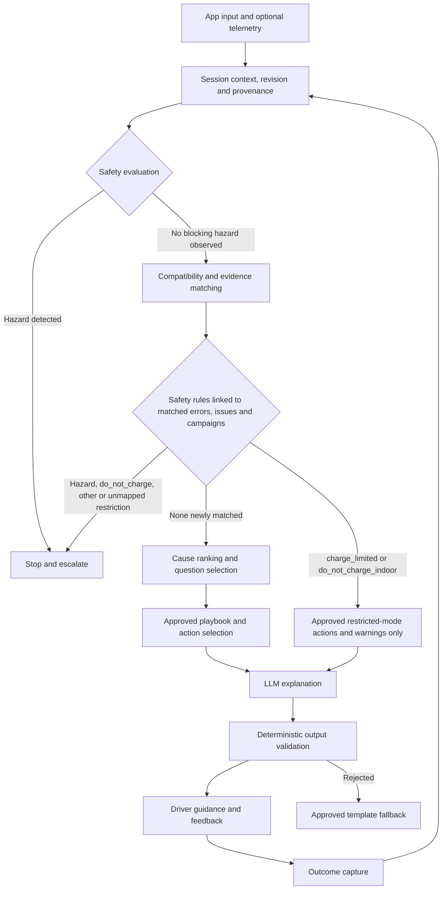

# FuelBuddy AI Charging Diagnostic System

**Technical specification — version 0.6**
**Date:** 21 October 2026
**Status:** Proposed implementation baseline; production knowledge requires source verification. v0.6 consolidates multi-AI review round 4 (no blocking or major finding; the review converged at this version); v0.5 consolidated round 3 and applied the decisions HUMAN settled on 2026-10-14 (FB-D1, FB-D2, FB-D3, FB-D5, FB-D7); v0.4 consolidated round 2 and v0.3 round 1. Passages marked **⚠ Pending HUMAN decision** are proposed, not settled.
**Scope:** Evidence-based diagnosis of EV charging failures and unexpectedly slow charging.

## 1. Purpose and principles

FuelBuddy correlates the exact vehicle configuration, charging equipment, operator, session stage, observed errors, and environmental conditions to identify probable causes and select safe next steps.

The same station can work with one vehicle and fail with another. Diagnosis must therefore consider both sides of the vehicle–station interaction, as well as authorization and operator infrastructure.

The system MUST:

- Distinguish observed facts, documented applicability, hypotheses, and unknown information.
- Separate likelihood from severity: a critical defect is not automatically the most likely cause.
- Match vehicle market, variant, equipment, and build range rather than model name alone.
- Treat generic error codes as symptoms unless additional evidence supports a specific cause.
- Produce safe, source-backed actions with explicit escalation criteria.
- Abstain when evidence is insufficient or conflicting, and state the abstention reason explicitly.
- Support community contributions through review and provenance, without automatically promoting reports into confirmed defects.

The system supports troubleshooting; it does not certify vehicle safety or replace OEM inspection. It MUST NOT declare a vehicle fault-free solely because a compatibility explanation was found.

### 1.1 Initial scope

The MVP supports manual vehicle selection, station identification, error transcription or image extraction, session-stage questions, and curated playbooks. Vehicle and operator integrations are optional capabilities, not prerequisites.

The initial catalog should cover a small, explicitly supported set of countries, vehicle variants, and station families. Each market requires its own connector, recall, and product applicability records.

**Supported-scope manifest.** The MVP MUST publish a versioned manifest stating exactly what it supports: markets, vehicle variants, charging modes, station families, protocol versions, and action coverage — and what general guidance remains available *outside* that scope. Requests outside the manifest resolve to `unsupported_scope` (§6.2), not to a best-effort guess.

**Market scope (FB-D1, settled by HUMAN on 2026-10-14).** The MVP market is **Europe**: the EU/EEA, the United Kingdom and Switzerland, and generally every country that has an API. "Has an API" is the inclusion rule for a country, not a fixed list. North America is out of MVP scope and may follow as a later-phase record set; SAE J3400 (§4.5) and NHTSA-based recall sources (§15 [S5]) belong to that phase.

Consequences of a multi-country scope:

- The spec cannot assume one regulator, one recall source or one legal frame. The supported-scope manifest records them per country.
- The in-scope connector types and protocol versions are set per country in the manifest, not assumed here.
- The seed examples in §7.1 and §8 are US-sourced and illustrative; they are not evidence for the MVP market, and European examples must be sourced separately.
- The privacy frame in §10 remains a proposal for FB-D4, which this decision does not settle.

**Open questions for HUMAN (carried forward):**

- **FB-D1a.** Which API makes a country eligible (for example public recall or safety data, charge-point status, or location data)? The spec does not choose one.
- **FB-D1b.** Which countries launch first?
- **FB-D1c.** Is a country without a usable API excluded, or served in a reduced mode?

## 2. Architecture



| Component | Responsibility |
| --- | --- |
| Vehicle provider | Resolve configuration and available telemetry; preserve missing values |
| Station provider | Resolve site, EVSE, connector, hardware, capabilities, and optional live state |
| Context builder | Normalize units, timestamps, identifiers, provenance, and freshness; assign session revision |
| Safety engine | Evaluate approved rules before diagnosis, after knowledge matching (rules linked to matched errors, issues and campaigns), and after every new observation; maintain typed safety state |
| Compatibility engine | Evaluate connector, adapter, voltage, current, protocol, and access constraints |
| Evidence matcher | Retrieve only applicable, approved knowledge and error mappings |
| Ranking engine | Score supporting and contradicting evidence; identify missing discriminators; decide `decision_status` |
| Playbook engine | Select approved actions for the current actor and hazard state |
| Action registry | Resolve approved, versioned action text and parameters; enforce retry budgets |
| LLM | Explain structured findings and phrase approved questions/actions |
| Output validator | Enforce schema, evidence references, action permissions, and safety decisions |
| Review pipeline | Verify sources, adjudicate reports, version knowledge, and support rollback |

The LLM MUST NOT override safety decisions, invent source references, issue station control commands, or generate electrical repair procedures. If the LLM is unavailable, deterministic guidance remains usable. Only a `do_not_charge` restriction (including `other` and unmapped values) or a hazard stops the flow; `charge_limited` and `do_not_charge_indoor` continue only into the actions and warnings on their §5 rows and never enter ordinary cause ranking or an unrestricted playbook.

**Session revision.** Every accepted observation or context correction increments a session revision. Every evaluation records `evaluation_id`, `input_revision`, `evaluated_at`, the knowledge/rule/ranking versions used, and the validity conditions of the actions it returns. A response whose revision or permissions are no longer current MUST be suppressed and reevaluated before display; hazard handling MUST NOT wait for LLM completion.

## 3. Data acquisition and availability

### 3.1 Operating modes

| Mode | Typical available information | Expected limitation |
| --- | --- | --- |
| Manual | Make/model/year/market, connector, display text, symptoms, session stage | Variant, firmware, internal faults, and actual capabilities may remain unknown |
| Public-data assisted | Published station details, AFIR national-access-point status (EU, §14), OEM specifications, recall campaign applicability | Public listing data is not proof of current station state or VIN recall completion; AFIR status is operator-reported status, not internal diagnostics |
| Partner integrated | Consented OEM telemetry, operator events, station capability and session logs | Availability varies by contract, vehicle, station, permission, and timestamp |

OCPP is the station-to-management interface; access to its internal events requires an appropriate operator integration. FuelBuddy MUST NOT assume a mobile app can directly obtain OCPP logs from arbitrary public stations.

### 3.2 Canonical observation record

There is exactly **one** observation record. Sections 3, 4, 9, and 11 refer to this definition; no section restates it.

| Field | Type | Required | Meaning |
| --- | --- | --- | --- |
| observation_id | UUID | yes | Stable identifier; the key referenced by candidates and outcomes |
| session_id | UUID | yes | Owning diagnostic session |
| attempt_id | UUID, nullable | no | Groups observations that belong to one plug-in/retry attempt |
| subject_type / subject_id | Enum / UUID | yes | What the observation is about: `vehicle`, `evse`, `connector`, `recharging_point`, `station_site`, `session`, `operator`, `environment`, `user`. `recharging_point` is the unit of AFIR status data (§14); it may hold several connectors and is not assumed to be an OCPP connector or EVSE. A payload that carries `session_id` once at top level (§9.1) supplies it to every observation it contains |
| observation_type | Enum | yes | `measurement`, `protocol_error`, `display_text`, `warning_indicator`, `session_stage_event`, `user_statement`, `image_transcription`, `recall_lookup`, `station_status`, `outcome` |
| stage | Enum, nullable | required when `observation_type = session_stage_event` | The §3.3 stage the event concerns, or `external_authorization` (§3.3). Applicability of a stage to the session's `communication_profile` is derived, not observed |
| stage_outcome | Enum, nullable | required when `observation_type = session_stage_event` | `entered`, `succeeded`, `failed`, `unknown`; an unspecified outcome is `unknown`. Only an effective event with `succeeded` establishes stage success (§3.3) |
| namespace | Enum | for protocol errors | See §4.5 |
| issuer | String, nullable | no | Emitting standard body, vendor, OEM, or operator |
| protocol_version | String, nullable | no | Bare version or edition; the protocol family is carried by `namespace`. E.g. `1.6` or `2.0.1` under `OCPP`; the edition (`-2`, `-20`) under `ISO_15118` |
| message_type / field_path | String, nullable | no | Where the value lives, so it can be re-resolved (§4.5) |
| component / variable / tech_code | String, nullable | no | OCPP 2.x device-model identity: the component and variable a `NotifyEvent` reports on, and the optional free-form `techCode`. `tech_code` refines but never replaces component and variable (§4.5) |
| ecu | String, nullable | required when `namespace = VEHICLE_DTC` | The control unit that reported the DTC; null for other namespaces. Part of the §4.5 mapping key |
| product_model / firmware_scope | String, nullable | no | Product and firmware the value is scoped to |
| raw_code | String, nullable | no | Code or status token exactly as emitted |
| raw_text | String, nullable | no | Human-readable text, verbatim, untrusted |
| value / unit | Number / String, nullable | no | Measurement and its unit; **`value` MUST be null, never `0`, when unknown** |
| measurement_kind | String (versioned catalog id), nullable | required when `observation_type = measurement` | The physical quantity measured, e.g. battery temperature versus ambient temperature, or charger output power versus battery input power. The reporter is carried by `measurement_location`, never by the kind. The catalog (see *Measurement-kind catalog* below) fixes, per kind, the allowed units, subject types, required qualifiers, and the charging-model inputs (§6.4) it may feed |
| measurement_location | Enum, nullable | required for power and energy kinds | Who or what reported the value: `vehicle_reported`, `charger_reported`, `meter`, `unknown` |
| aggregation_kind | Enum, nullable | required for power and energy kinds | `instantaneous`, `average`, `energy`, `unknown` |
| window_start / window_end | Timestamp (UTC), nullable | required when `aggregation_kind` is `average` or `energy` | The averaging or accumulation window |
| source_type | Enum | yes | See below |
| source_reference | String | yes | Document URL, integration name, or user input locator |
| quality | Enum | yes | `confirmed`, `reported`, `inferred`, `unknown` |
| observed_at | Timestamp (UTC), nullable | no | When the event happened; null when unknown |
| observed_at_precision | Enum | no | `second`, `minute`, `hour`, `unknown` |
| clock_source | Enum | no | `station`, `vehicle`, `phone`, `backend`, `unknown` |
| received_at | Timestamp (UTC) | yes | Service-assigned receipt time; never substituted silently for `observed_at` |
| conflict_group_id | UUID, nullable | no | Groups observations that conflict, so both are retained and linked |
| corrects_observation_id | UUID, nullable | no | Set when this observation corrects an earlier one |

`source_type` enum (used for both evidence and observations): `oem`, `regulator`, `standard`, `vendor_manual`, `operator`, `partner_integration`, `vehicle_telemetry`, `confirmed_service_outcome`, `community_report`, `unknown`.

**Station-status payload.** An observation with `observation_type = station_status` carries typed state values, each from a versioned vocabulary that includes `unknown`: `operational_state`, `availability_state` and `power_sharing_state`. `availability_state` is nullable and is kept separate from `operational_state` (§14 maps each AFIR data type to its own member). The vocabularies, their versions and the source-field binding of each member are part of the release manifest (§12); this spec does not list their values. Available station power is not a status value: it is a `measurement` observation whose catalog kind means available station allocation (unit kW, with the subject, location and temporal qualifiers the catalog requires). The §4.3 `available_power_kw` field is an alias resolved from that observation.

**Measurement identity.** `raw_text` is never the authoritative substitute for `measurement_kind` or its qualifiers. An unknown required qualifier stays `unknown` and makes any comparison that needs it `insufficient_evidence` (§6.4). A comparison requires the same kind. Two measurements with the same subject and unit but different kinds, locations, or aggregations MUST NOT be substituted for one another (fixture in §12), except that the catalog may state an explicit rule for comparing the same kind from differing reporters.

**Measurement-kind catalog.** The catalog is a separate versioned, reviewed artefact (not the §4 knowledge base). Each entry holds `kind_id`, catalog version, allowed units, allowed subject types, required qualifiers, any comparison rule for differing reporters, the charging-model inputs it may feed, `evidence_ids`, and the reviewer. It is bound to the release manifest (§12) and built in the evidence-foundation phase (§13).

Missing values MUST remain null/unknown. Zero MUST NOT represent unavailable power, temperature, or state of charge. Conflicting observations are retained and flagged via `conflict_group_id` rather than silently overwritten. Timestamps from different clocks are not comparable without `clock_source`; the stage and freshness logic MUST account for this.

A correction does not delete its predecessor: both are kept for audit, and a versioned *effective-observation* view excludes superseded transcription values from active matching.

**Outcome observations.** An `outcome` observation has `subject_type = session`, and so carries every required field above. Its typed payload (§11) adds `cause_id`, the outcome value, supporting and contradicting `observation_ids`, `actor` and `evidence_ids`; its confirmation quality is the `quality` field. There is no second outcome record shape.

### 3.3 Session stages

Normalize stage to one of:

`discovery`, `connected`, `authorization`, `communication_setup`, `parameter_negotiation`, `safety_checks`, `power_delivery`, `charging`, `stopping`, `unknown`.

`external_authorization` is also a valid `stage` value of a `session_stage_event`; it is an event value, not a step in any profile's order. `not_applicable` is never a `stage` value: it is derived from the profile.

The stages are **not one fixed linear order.** The expected order depends on the communication profile and the authorization method. Two separate things are both called "authorization" and MUST be recorded apart:

- **External identification** (RFID, app, ad hoc payment): recorded as an `external_authorization` session-stage event whose position relative to plug-in is not fixed. It is not the `authorization` stage.
- **Protocol authorization** (the `authorization` stage): the identification and authorization exchange *inside* a high-level communication session — service discovery, payment-service selection and, for Plug & Charge, the contract-certificate and Authorization exchange. It follows `communication_setup` and precedes `parameter_negotiation` (charge-parameter discovery).

**Session record.** A session carries `session_id`, `communication_profile` and `authorization_method`, plus the session revision (§2). Stages are recorded as `session_stage_event` observations with the `stage` field of §3.2; "last successful stage" and the applicability of each stage are derived from those events and the profile, not stored as separate observed values. `communication_profile` is one of `iec61851_pwm_only`, `iso15118`, `din70121`, `chademo`, or `unknown`.

| communication_profile | Applicable stage order (abridged) |
| --- | --- |
| `iso15118` | discovery → connected → communication_setup (incl. SLAC, association, session setup) → **authorization** → parameter_negotiation → [`safety_checks`: DC only, cable check then precharge; `not_applicable` on AC] → power_delivery → charging → stopping |
| `din70121` | DC only. Same order as the DC `iso15118` row, with `safety_checks` always applicable. `plug_and_charge` is rejected. The protocol payment option is external, so the contract exchange is empty; `rfid`, `app`, `ad_hoc_payment` and `free` stay allowed and are recorded as `external_authorization` when an identification event exists. Do not read this row as `ad_hoc_payment` only |
| `iec61851_pwm_only` (basic AC, control pilot only) | discovery → connected → power_delivery → charging → stopping; `communication_setup`, `authorization`, `parameter_negotiation` and `safety_checks` are `not_applicable` (not failed or skipped); external identification may occur at any point |
| `chademo` | discovery → connected → communication_setup → parameter_negotiation → `safety_checks` (insulation test before the vehicle battery is connected) → power_delivery → charging → stopping. Protocol `authorization` is `not_applicable`; external identification is an `external_authorization` event. **Provisional:** taken from a vendor application note ([S11]), pending the CHAdeMO text; do not reuse ISO 15118 message names |
| `unknown` | record the observed order; do not assume |

`authorization_method` (`rfid`, `app`, `plug_and_charge`, `ad_hoc_payment`, `free`, `unknown`) says how the user is identified. For `plug_and_charge` the protocol `authorization` stage carries the contract exchange; for `rfid`, `app` and `ad_hoc_payment` the `external_authorization` event is recorded separately, and an ISO 15118 session still passes through its own `authorization` stage. "Last successful stage" is interpreted only along the stages applicable to the profile; a stage marked `not_applicable` is never a failure point. That cable check and precharge belong to the DC sequence only rests on secondary descriptions of ISO 15118-2 ([S7]) and DIN SPEC 70121 ([S10]) and is to be confirmed against the standards before encoding; the same holds for the CHAdeMO order.

**Stage outcome.** A `session_stage_event` carries a `stage_outcome` (§3.2). Only an effective event with `stage_outcome = succeeded` establishes that a stage succeeded. The last successful stage is derived for the current attempt (`attempt_id`) along the applicable profile order: success is not inferred from the mere presence of a stage event and is not inherited from a previous attempt. Events with different `clock_source` values are not ordered against each other, and `received_at` gives receipt order, not occurrence order. If attempt membership or ordering cannot be resolved, uncertainty is preserved and the last successful stage stays `unknown`.

**Profile and method consistency.** `plug_and_charge` is allowed only with `iso15118`; it is rejected for `iec61851_pwm_only`, `chademo` and `din70121`. When the profile is `unknown`, the combination is preserved as unknown, not assumed. For `free`, no `external_authorization` event is required; for `unknown`, none is inferred.

Record also the failure timestamp, raw error text, repeat count, and whether another connector, station, network, or charging mode was tested.

## 4. Knowledge base schema

Use relational identifiers and join tables for applicability. JSON may preserve raw evidence and optional attributes; it should not replace referential integrity.

### 4.1 Common evidence fields

Every issue, compatibility assertion, error mapping, and playbook MUST reference evidence records.

| Field | Type | Meaning |
| --- | --- | --- |
| evidence_id | UUID | Stable evidence identifier |
| source_type | Enum | The §3.2 `source_type` enum |
| source_url | String | Original document or accessible source location |
| title / publisher | String | Source identity |
| published_at / accessed_at | Timestamp | Publication and retrieval dates |
| document_version / locator | String | Edition, page, section, or campaign identifier |
| market | String | Jurisdiction or product market |
| verification_status | Enum | Unverified, under_review, approved, rejected (see below) |
| reviewed_by / reviewed_at | String / timestamp | Accountable review; for safety content, the §4.7 `safety_reviewer` |
| valid_from / valid_until | Timestamp, nullable | Applicability interval (`valid_until` is informational) |
| supersedes_id | UUID, nullable | Previous assertion or record |
| incident_id | UUID, nullable | Groups documents and reports that describe the same real-world failure event, so they count once in ranking (§6.2) whatever their source URL or document version; null means the record is its own incident, identified by `evidence_id` |
| permitted_use | String | License or access restrictions |

**Verification and supersession.** `supersedes_id` is the single source of truth for revision; there is no separate `superseded` status value (supersession is derived, not stored). For B with `B.supersedes_id = A.id`, A is the predecessor and B the successor. A is superseded for production activation only when an approved successor B is activated under the release policy; B's non-null pointer does not make B superseded, and an unapproved draft successor does not deactivate A. Self-links and cycles are rejected. Only `approved` knowledge can justify production diagnostic claims. Community reports can inform questions or investigation, with their status displayed internally and never presented as established OEM defects.

**Dependency-aware activation.** A production assertion, safety rule, or playbook is active only if *all* of its required evidence and approvals are currently usable under their approved policy. When evidence is withdrawn or superseded, dependents are invalidated together. Releases are immutable, versioned manifests of rules, evidence, playbooks, and supported scope, carrying integrity checks, review dates, a validity policy, a rollback target, and revocation handling.

**Cached knowledge packages (FB-D5, settled by HUMAN on 2026-10-14).** Principle: stale or unverifiable data MUST never make the app more permissive than verified data would. When a cached package's validity cannot be established:

| Cached content | Behaviour |
| --- | --- |
| Safety rules and the hazard message | Always available and always shown; they are conservative, so staleness cannot make them more dangerous |
| Restrictions and recall campaigns | Known restrictions stay in force and are never cleared offline. Show "last checked <date>". A missing or old recall status is never treated as "no recall" (it stays `unknown`) |
| Approved diagnostic playbooks | Available with a visible "may be out of date, last updated <date>" notice; only bounded approved actions with fixed retry limits |
| Items marked withdrawn or superseded | Not shown once the app knows. When it cannot know, shown as "unverified", not as current guidance |
| LLM-written explanations | Not available offline; fall back to the approved rendered text (§9.2) |

A package that is merely old keeps working with the notice. A package older than a hard limit is restricted to safety content plus a plain "update when you have signal" message. Weak connectivity is common at charging sites, so a hard block on "cannot verify" is not acceptable behaviour. **Open question for HUMAN (FB-D5a, carried forward):** the hard age limit. This spec states no number.

### 4.2 Vehicle variants and instances

| Table | Key fields |
| --- | --- |
| vehicle_variants | variant_id, make, model, market, model_year_start/end, build_date_start/end, trim, battery_variant, usable_capacity_kwh, max_dc_kw, max_ac_kw, nominal_voltage_v, dc_input_voltage_min/max_v, ac_input_voltage_min/max_v, ac_input_current_max_a, ac_phase_count, obc_power_kw, supported_protocols |
| vehicle_connectors | variant_id, inlet_type, charge_mode, supported_adapters, restrictions |
| vehicle_conversion_capabilities | variant_id, equipment_code, input_voltage_range, output_limit_kw, equipment_required, verification_method |
| vehicle_instances | vehicle_instance_id, variant_id, protected_vin_reference, equipment_confirmed, software_version, software_observed_at |
| vehicle_issue_applicability | issue_id, variant_id, market, build_range, software_range, equipment_predicates |
| vehicle_campaign_status | vehicle_instance_id, campaign_id, status, checked_at, source_reference, lookup_scope, superseded_by |

`charge_mode` enum: `ac`, `dc`, `unknown`. Wireless power transfer is out of scope (§4.5); a wireless input resolves to `unsupported_scope`. `supported_adapters` is a relation to connector records, not free text. AC electrical fields mirror the DC ones so the AC path of both compatibility (§4.6) and slow-charging analysis (§6.4) can be computed.

VIN decoding is an identification aid. Battery trim, converter fitment, software version, and repair history require separate confirmation when they affect the decision. Software belongs to the vehicle instance, not a static model profile.

**Applicability predicates.** Predicates (build ranges, equipment, software ranges, connector/adapter, capability) use a typed, versioned grammar and evaluate to exactly one of `true`, `false`, or `unknown` (§6.1). The join table `vehicle_issue_applicability` is **derived by evaluating these predicates** — it is not a second, independent source of truth; the two MUST NOT be maintained by hand in parallel. Software comparison uses the issuer's documented version ordering, never generic string ordering. An `unknown` required input cannot satisfy a positive *or* a negative predicate.

### 4.3 Charging infrastructure

| Table | Key fields |
| --- | --- |
| station_sites | site_id, operator_id, network_brand, country, location, support_contact |
| evses | evse_id, site_id, manufacturer, hardware_model, hardware_revision, firmware_version, firmware_observed_at, management_protocol/version |
| connectors | connector_id, evse_id, connector_type, charge_mode, voltage_min/max_v, current_max_a, power_max_kw, adapter_policy |
| station_observations | A projection of the §3.2 record, not a second shape: `observation_id`, `subject_type` and `subject_id` (a `connector` or a `recharging_point`), `observation_type` ∈ {`station_status`, `measurement`}, `observed_at`, `received_at`, `source_type`, `source_reference`, `quality`, plus `operational_state`, `availability_state` and `power_sharing_state` (the §3.2 station-status payload) and `available_power_kw` (an alias resolved from the §3.2 available-allocation `measurement` observation). The projection resolves the underlying observations by `observation_id` and keeps each value's own provenance and timestamp; it never stores an independent, competing state. A `recharging_point` observation keeps its point subject; it resolves to a connector only through a documented identity relation and is never copied onto connectors |

Rated power and currently available power are separate fields. Unknown hardware or firmware MUST NOT be filled from network-wide assumptions. A station listing identifies a site; connector-level identity is needed for diagnosis.

### 4.4 Known issues and recall campaigns

| Field | Type | Meaning |
| --- | --- | --- |
| issue_id | UUID | Stable issue identifier |
| affected_side | Enum | Vehicle, station, operator, interoperability, user_setup, environment |
| category | Enum | Battery, low_voltage, charging_controller, contactor, thermal, connector, authorization, payment, communication, software, other |
| description | String | Evidence-backed description |
| symptoms | Related records | Normalized symptoms with applicability |
| dtc_codes | Related records | Issuer, ECU, code, version, and confirmed meaning |
| severity | Enum | Critical, high, medium, low |
| safety_rule_ids | Relations | Safety rules this issue can trigger (§5) |
| support_conditions | Predicates | Observations supporting this hypothesis |
| contradiction_conditions | Predicates | Observations weakening this hypothesis |
| playbook_ids | Relations | Approved resolution procedures |
| evidence_ids | Relations | Supporting sources |

The field is `dtc_codes`. Do not invent codes when a source does not publish them.

**Severity reaches safety through `safety_rule_ids`.** A `Critical` issue is not automatically a hazard; it affects the safety engine only through the safety rules it is linked to. This keeps severity (a property of a cause) distinct from safety state (a property of the session).

Recall campaigns are separate records: `campaign_id`, `authority`, `market`, `OEM_reference`, `affected_build_range`, `instructions`, `remedy`, `restriction`, and `evidence_ids`.

`restriction` enum: `none`, `do_not_charge`, `charge_limited`, `do_not_charge_indoor`, `other`, plus free text. Each value maps to driver-facing behaviour as settled in §5 (FB-D2). `other`, or any value without a human-approved mapping, behaves as `do_not_charge`; free text is never read to infer a milder behaviour.

**Per-campaign recall state.** For an individual vehicle, recall state is held per campaign in `vehicle_campaign_status` (vehicle_instance_id × campaign_id), each with status `confirmed_open`, `confirmed_completed`, `potentially_applicable`, `not_applicable`, or `unknown`, plus `checked_at`, source reference, and the lookup's scope and limitations. A scalar per-vehicle `recall_status` is not sufficient: completing one campaign must not conceal another open one. Model/year matching alone cannot establish an open VIN-specific recall; a no-result lookup remains `unknown` for that campaign; and a completed campaign does not establish absence of a current component fault.

### 4.5 Error mappings

Mapping key:

`namespace + issuer + ecu + protocol_version + message_type + field_path + component + variable + tech_code + product_model + firmware_scope + raw_code`.

`message_type` and `field_path` are required because the same value means different things in different messages (e.g. OCPP 1.6 `StatusNotification.errorCode` versus OCPP 2.0.1 `NotifyEvent` on a device-model component). In OCPP 2.0.1 there is no `StatusNotification.errorCode`: a fault is a `NotifyEvent` report for a specific device-model component and variable, with optional free-form `techCode` and `techInfo`, and the station's device model decides what is reported ([S3]). Therefore an OCPP 2.x device-model mapping requires `message_type = NotifyEvent` plus `component` and `variable`; `tech_code` distinguishes vendor detail when present and is not a substitute for component and variable; a mapping that lacks component and variable MUST NOT match a 2.x device-model event. For other namespaces `component`, `variable` and `tech_code` are null. `ecu` is required when `namespace = VEHICLE_DTC` and null otherwise, so the same numeric DTC reported by two control units on one vehicle does not collide; a mapping without an ECU never matches a `VEHICLE_DTC` observation. No fixed cross-version map from OCPP 1.6 `ChargePointErrorCode` values onto 2.0.1 events is assumed. Fields include raw text, normalized category, session stage, possible causes, safety semantics, evidence references, and approved playbook links.

Keep these namespaces distinct:

- `OCPP` — OCPP standard error/status fields, with exact version, message type, and field path.
- `OCPP_VENDOR` — OCPP vendor error codes and operator display codes.
- `ISO_15118`, `DIN_SPEC_70121` — protocol responses, scoped to edition and charging mode.
- `CHADEMO` — CAN-based status and error flags.
- `IEC61851_CP_STATE` — control-pilot states A–F. States A–D are the normal connection sequence; state E is the error state (pilot short or utility power unavailable); state F means the EVSE is not available, for example during maintenance. Neither E nor F is energy transfer, and they are not the same condition. "Stuck in state B" is a common AC symptom. Do not treat a displayed letter as a control-pilot state until the source of the letter is identified; voltages and clause numbers are not specified here until checked against IEC 61851-1 ([S8], vendor summary).
- `SLAC` — HomePlug Green PHY matching, the sub-step preceding ISO 15118/DIN communication.
- `SAE_J3400` — reserved for the later North America phase; not in MVP scope (FB-D1).
- `VENDOR_DIAGNOSTIC` — vendor diagnostic identifiers, including numeric codes published in a charger manual.
- `VEHICLE_DTC` — vehicle DTCs scoped to the OEM/ECU.
- `FUELBUDDY_INTERNAL` — internal observations and safety rule identifiers.

**Explicitly out of scope** (name them, do not implement): GB/T, MCS (Megawatt Charging System), and wireless power transfer. Such inputs resolve to `unsupported_scope` (§6.2).

Standard-field mappings and vendor/firmware-specific mappings MUST be distinguished: an approved standard-field mapping may match a known protocol version with unknown firmware, but a vendor mapping that requires firmware confirmation must not match when firmware is unknown.

The DIN reference is `DIN SPEC 70121`. Do not label Bosch numeric diagnostic identifiers as universal ISO/CCS error numbers.

**⚠ Open question (CLAUDE-11).** The example identifier `FAILED_AlignmentError` could not be found in any public source on 2026-10-11. It is removed from the normative examples and retained only as a caution: do not interpret any such name as a plug-seating fault without verifying the exact edition, message, and charging mode in which it is defined.

### 4.6 Compatibility assertions

Fields: `assertion_id`, vehicle variant/configuration predicates, connector/adapter requirements, station capability predicates, protocol/firmware predicates, market, effective dates, evidence_ids, and result.

Results: `compatible`, `compatible_with_limitations`, `documented_incompatible`, `unknown`, `conflicting_evidence`.

Compatibility requires a *documented feasible operating point* satisfying all relevant constraints, including conversion and adapter limits. Nominal-voltage match or interval overlap alone is insufficient. Where predicates are involved, `unknown` required inputs cannot produce a positive result; conflicting applicable assertions return `conflicting_evidence` unless an approved precedence/supersession rule resolves them.

An 800V nominal architecture does not alone establish incompatibility with a lower-voltage station. Evaluate vehicle accepted input range, confirmed conversion equipment, station actual voltage range, current limits, adapter approval, and authorization access.

### 4.7 Resolution playbooks

Each playbook contains `playbook_id`, version, actor (`driver`, `operator`, `qualified_technician`), prerequisites, blocking hazards, ordered actions, maximum retries, stop conditions, escalation contact type, evidence_ids, approval status, and `safety_reviewer`.

Driver responses MUST exclude operator and technician actions. Station grounding inspection, head assembly removal, opening enclosures, mains isolation, high-voltage repair, and protection bypass are never driver troubleshooting steps.

**Action registry.** Executable guidance is a set of approved, versioned artefacts, not free text. The registry links `action_id` → `playbook_id`/version, actor, approved localized text, parameters, prerequisites, blocking hazards, and retry-budget scope.

**Retry ledger.** Action recommendations and reported attempts are recorded with `action_id`/version, `attempt_id`, subject, timestamps, outcome, and confirmation quality. Retry budgets are consumed and evaluated across the scope the playbook specifies; starting a new diagnostic session or switching clients MUST NOT silently reset an exhausted budget. When prior attempt history is unavailable, the system asks for it and applies HUMAN-approved conservative defaults.

**Safety approval.** A `safety_reviewer` — a qualified person, named per release — MUST approve every safety rule and blocking-hazard playbook, and is recorded in `reviewed_by`.

**Emergency stop and stuck connector (FB-D3, settled by HUMAN on 2026-10-14).**

- **No emergency-stop instruction from the app.** The app has no sensor on the charger; a hazard reaches it only through what the driver reports or through an operator or station fault feed (§5). It never originates advice to use a physical emergency control. It may display an instruction that the station operator has published and the registry has approved, shown as operator-originated guidance.
- **Stuck connector.** A playbook covers a connector that will not release after charging (`stopping` stage). Every action comes from an OEM or standards source with `evidence_ids`, like any other playbook, and it never advises forcing the plug or pulling the cable. When the OEM publishes no procedure, the app says so and escalates to the operator or roadside assistance instead of improvising.
- The emergency-message wording (§5) should receive legal review together with FB-D4; this is not a blocker.

## 5. Safety policy

Safety is independent of the statistical ranking engine and runs before diagnosis, after new observations, and during final output validation.

**Typed safety state.** The safety engine maintains an explicit state object: matched `rule_ids`, affected vehicle/equipment scope, triggering `observation_ids`, and clearance conditions. Restrictions are cleared only by evidence and an actor authorized by the applicable rule — never by the passage of time, a missing warning, or a later successful session.

**Safety-state vocabulary.** The `safety_state` value carried in the LLM payload (§9.1) and output (§9.2) is a closed, versioned enum derived from the typed state object and set only by the safety engine. In order from least to most restrictive: `no_blocking_hazard_observed`; `restricted` (only `charge_limited` or `do_not_charge_indoor` restrictions apply); `stopped` (a reported hazard applies, or a `do_not_charge`, `other` or unmapped restriction applies). The value is never made less restrictive by a later observation, a missing warning, an LLM response or a fallback path; it is lowered only by a clearance under the rules below. The labels are provisional until the `safety_reviewer` approves them, and the enum and its version are bound to the release manifest (§12).

**Clearance semantics (FB-D2, settled by HUMAN on 2026-10-14).**

> Credible reports of damage or a potentially safety-related warning suspend retry and alternate-charging recommendations pending the relevant approved triage playbook; a generic unclassified error alone does not establish a hazard. Missing or contradictory observations do not clear an active restriction. Each restriction can be cleared only by evidence and an actor authorized by its approved rule; a successful charging session does not itself clear it.

With these amendments:

1. **Fail closed on unknowns.** `other`, or any restriction value without a human-approved mapping, behaves as `do_not_charge` until a reviewed mapping exists. Free text is never read to infer a milder behaviour.
2. **Authorized actor per class.** A recall restriction is cleared only by an authority or OEM source showing that campaign completed (VIN-level lookup or remedy record), never by a driver statement. A restriction on damaged or faulted charging equipment is cleared by the operator or site owner, or their status feed. A vehicle high-voltage fault or fire/thermal event is cleared by qualified service or an OEM-authorized inspection.
3. **Users can raise, not clear.** A driver report can raise a restriction. Self-clearing is out of MVP scope.
4. **Scope.** Equipment-scoped restrictions (charger, connector) stay with that equipment and do not block the vehicle elsewhere. Vehicle-scoped and campaign-scoped restrictions follow the vehicle. When restrictions conflict, the most restrictive wins.
5. **Re-verification prompt, not expiry.** After a period HUMAN approves, advice to other drivers about an equipment restriction downgrades to "unverified, last reported on <date>, check the operator". The restriction is never cleared by time alone. **Open question for HUMAN (FB-D2a, carried forward):** the period. This spec states no number.

Restriction values map to driver-facing behaviour as follows:

| `restriction` value | Driver-facing behaviour |
| --- | --- |
| `none` | Normal flow with the usual bounded approved actions |
| `do_not_charge` | No retry or alternate-charging advice; show the exact approved text; escalate to OEM or service |
| `charge_limited` | Only the approved limited-charging instructions as published; nothing else |
| `do_not_charge_indoor` | Outdoor-only guidance with the approved warning |
| `other` or unmapped | Treated as `do_not_charge` (amendment 1) |

**Combining restrictions.** When several restrictions apply at once, each is evaluated against its own subject scope (amendment 4), and an action is permitted only if every applicable restriction permits it. `do_not_charge` (including `other` and unmapped values) permits no charging action. Otherwise all applicable limits and approved warnings are retained rather than choosing one enum value, so `charge_limited` and `do_not_charge_indoor` together keep both conditions. If no approved action satisfies the combined conditions, return approved escalation guidance. This composes the settled "most restrictive wins" rule; it changes no approved instruction or clearance rule.

**Hazard screening (FB-D3, settled by HUMAN on 2026-10-14).** The app is not a smoke or fire detector. A hazard reaches it only as a driver report (typed or spoken text, an intake answer, a photo hint the driver confirms) or as an operator or station fault-feed report.

- Every session begins with a hazard screening question (smoke, sparks, melted or burnt parts, burning smell). A yes goes straight to the emergency message below. The same check runs on free-text and voice input.
- A photo can at most raise a hazard hint that becomes a question to the driver, never a conclusion.
- Fault codes from a station feed (for example OCPP `GroundFailure`, `OverCurrentFailure`, `HighTemperature`) are not by themselves evidence of fire.
- The app never originates advice to use a physical emergency control (§4.7).

| Reported observation (source) | Required driver-facing behavior |
| --- | --- |
| Driver reports smoke, fire, sparks or arcing, melted or burnt parts, a suspected battery thermal event, or a credible burning smell | Stop troubleshooting; move away, keep others clear, and contact local emergency services when fire or immediate danger is suspected; do not touch or attempt to unplug damaged or actively hazardous equipment |
| Operator or feed reports a ground/insulation fault or damaged charging equipment, or the driver reports visible damage | Stop use of the affected equipment; do not retry there; contact operator and follow approved guidance |
| Vehicle displays a high-voltage fault or loss-of-propulsion warning (driver- or telemetry-reported) | Follow the applicable OEM warning; halt charging troubleshooting and escalate to roadside assistance or qualified service as appropriate |
| Applicable recall charging restriction | Display the exact approved restriction and applicability status; do not substitute a blanket model-wide instruction |
| Ordinary failed handshake without hazard evidence | Allow only bounded, approved user actions |

A generic error code is not proof of a fire, and a lack of errors is not proof of safety. Weather humidity alone is not evidence of water ingress. Ambient temperature is not battery temperature. Weather-based restrictions require an approved policy and relevant conditions.

Emergency contact numbers are reviewed per-country configuration (EU/EEA, UK, Switzerland, and any other supported country); they are never hard-coded. The wording of this safety policy and of the emergency message should receive legal review together with FB-D4; this is not a blocker. The app does not automatically call services or manipulate a charging session without a separately authorized feature.

## 6. Matching and ranking

### 6.1 Processing sequence

1. Validate inputs and preserve uncertainty. Apply the §5 hazard screening to the intake answer and to free-text and voice input.
2. Build the session context, assign the session revision, and identify the last successful stage (per §3.3's method-dependent order).
3. Evaluate safety and vehicle-specific restrictions.
4. Resolve vehicle configuration and connector identity as far as evidence permits.
5. Evaluate physical/electrical/protocol/access compatibility using three-valued predicates.
6. Retrieve applicable errors and known issues.
7. Evaluate the safety rules linked to the newly matched errors, issues, and applicable campaigns using the resolved context, independently of candidate ranking. Refresh the typed safety state before selecting questions, playbooks, or actions; final validation (step 13) checks permissions against that refreshed state.
8. Generate candidate causes, including ordinary causes and unknown/unmodeled causes.
9. Score supporting evidence, contradiction, specificity, reliability, and freshness.
10. Decide `decision_status` (§6.2); abstain with a reason when evidence is insufficient or conflicting.
11. Select the most useful safe clarification question when it can change the next action.
12. Select approved playbooks, actions, and escalation paths.
13. Generate and validate the explanation.
14. Capture outcome with its confirmation quality.

### 6.2 MVP ranking

Use a versioned deterministic evidence score for ordering, **not a probability**.

`score(cause) = supporting(cause) − contradicting(cause) + specificity(cause) − uncertainty(cause)`

Each term is a defined function over observation and evidence records, and the whole formula is versioned:

| Term | Range | Definition |
| --- | --- | --- |
| `supporting` | [0, 1] | Sum over **distinct evidence groups** of `reliability_weight × quality_weight`, capped at 1. The identity of an evidence group is its `incident_id` when non-null, independent of source URL and document version; a null `incident_id` makes the record its own incident, identified by `evidence_id` (§4.1). Source and document metadata remain provenance and never split a known shared incident, so copied reports are not counted twice. The ranking policy defines aggregation within each group. |
| `contradicting` | [0, 1] | The same function over contradicting observations, using the same evidence-group identity as `supporting`: each contradicting observation is grouped through the evidence behind it by `incident_id` (null: `evidence_id`), and an observation with no evidence record is its own group, identified by `observation_id`, so a copied contradicting report adds one contribution. `reliability_weight` and `quality_weight` come from the ranking policy tables, keyed by `source_type` and the observation's `quality` (§3.2). `conflict_group_id` groups mutually conflicting observations and is not the dedup key. |
| `specificity` | [0, 0.5] | Applies **only if `supporting > 0`**. A precisely matching known issue cannot raise a cause that has no supporting observation. |
| `uncertainty` | [0, 0.5] | Proportional to the number of missing discriminators for that cause. |

Weights require documented rationale and validation; they are never tuned silently. **Specificity is not likelihood**, just as severity is not likelihood. Severity determines safety review and escalation priority only. A named known issue carrying only model/year applicability remains a hypothesis, and a specificity lift alone cannot outrank an ordinary cause that has supporting observations.

**Ordering** within an evaluation is deterministic and stable: descending `score`, then ascending `cause_id`. (`decision_status` is evaluation-level and is not a sort key.) The documented ordering of cause classes (FB-D7, below) is part of the ranking-policy contract. "Cause" and "candidate" are synonyms in this document; the identifier is `cause_id` everywhere.

**Ranking-policy contract.** Each ranking-policy version defines the reliability and quality tables, within-group aggregation, the `specificity` function, the missing-discriminator normalization for `uncertainty`, the evidence-strength rules, and the precedence among decision statuses. Before ranking is enabled in a release, the complete policy is bound to the release manifest (§12) together with a fixture of at least three candidates — including a tie, missing inputs, and contradictory evidence — with exact expected scores, labels, and ordering. This spec contains no worked example yet, and no guessed weights or thresholds; pilot-derived thresholds are versioned separately.

**Decision status (MVP abstention contract).** Every evaluation states a `decision_status`:

| status | Meaning |
| --- | --- |
| `supported_hypothesis` | At least one candidate has supporting evidence above the (pilot-set) threshold |
| `insufficient_evidence` | No candidate reaches the threshold; return approved questions/escalation instead |
| `conflicting_evidence` | Applicable evidence conflicts without an approved precedence rule |
| `unsupported_scope` | The configuration is outside the supported-scope manifest (§1.1) |

The ranked list may be **empty**; a top weak candidate MUST NOT be presented as the probable diagnosis. Numeric thresholds are set from pilot evidence (§13), not invented here. `decision_status`, its reasons, and `evidence_strength` are always included in the output.

Display evidence strength as `strong`, `moderate`, `weak`, or `insufficient`, with reasons and missing information.

**`unsupported_scope` response.** A response with `decision_status = unsupported_scope` still runs and displays the §5 safety evaluation and any applicable restriction. It returns the manifest's declared general guidance as approved questions, actions and escalation, and states which manifest entry is missing or unsupported. It MUST NOT be presented as a `supported_hypothesis` or as a cause-specific playbook. This defines the response contract only; which countries and configurations are in scope remains open (FB-D1a–c).

**Documented ordering (FB-D7, settled by HUMAN on 2026-10-14: Option A).** The MVP ships a documented, not yet calibrated, ordering: ordinary causes (station fault, authorization, cable, user setup) first, with specificity gated as above. Calibrated base rates stay deferred to §6.3, and ranking is not blocked until calibration. This spec adds no calibrated numbers; the ordering is versioned in the ranking policy and its fixture.

### 6.3 Later probabilistic model

Planned follow-up to the documented ordering of §6.2 (FB-D7). Percentages are allowed only after validation against independently confirmed outcomes, with calibration assessment by supported segment. Maintain an explicit unknown-cause option and abstain for unsupported configurations or distribution shift. Do not force a few retrieved causes to total 100%.

### 6.4 Slow charging analysis

Compare observed power against an expected envelope produced by an explicit, versioned **charging-model interface**:

- Inputs: vehicle onboard-charger capability (`max_ac_kw`, `ac_input_voltage_min/max_v`, `ac_input_current_max_a`, `ac_phase_count`, `obc_power_kw`), connector/cable limits, station allocation, SoC, battery temperature/preconditioning, DC charging curve at observed SoC, station voltage/current/power constraints, shared power, session timing.
- Output: an expected power **envelope** (a band over time, in kW) with an uncertainty and an applicability description — not a single number.
- Provenance: `model_version`, applicable configuration, and the source of each charging curve.
- Measurement contract: the *location* of the measured power (vehicle-reported vs charger-reported vs meter), the averaging interval, and the observation window, carried by the typed §3.2 fields `measurement_kind`, `measurement_location`, `aggregation_kind` and `window_start`/`window_end`; a comparison whose required kind or qualifier is `unknown` returns `insufficient_evidence`. Charger output power and battery input power are different kinds and MUST NOT be compared as though they measured the same quantity; the same kind from differing reporters is compared only under the catalog's rule (§3.2).
- Failure: if required inputs are missing, the model returns `insufficient_evidence`; peak advertised power is never substituted as an expected constant.

Declare slow charging only when the measurement contract and expected conditions support it. Missing battery temperature or power-sharing data lowers evidence strength. Ramp-up, taper, shared allocation, and incompatible measurement boundaries are explicit test cases (§12).

## 7. Illustrative sourced examples and unresolved claims

This document does not certify a complete vehicle or station issue catalog. The MVP market is Europe (§1.1), but the examples below are US-sourced: they illustrate the record format and verification boundary only and are not evidence for the MVP market. The original populated tables MUST NOT be imported as approved production records. The examples below are *illustrative* and carry their verification boundary: each records its source locator, retrieval date, status, and exact scope, and none is evidence of a particular vehicle's current campaign state or equipment fitment.

### 7.1 Illustrative sourced examples

| Topic | Illustrative assertion | Status, scope and limitation |
| --- | --- | --- |
| Hyundai ICCU recall | Hyundai notice 24V-868 / campaign 272 identifies certain 2022–2024 Ioniq 5 and 2023–2025 Ioniq 6 vehicles [S1], checked 2026-10-11 | Scope is the campaign's own eligibility and remedy. The owner notice gives **no build-date range** (take it from the Part 573 report) and states **no interim charging restriction**; the failure presents through 12 V / fail-safe warnings and power loss, not a charging error. Do not extend to Ioniq 9, EV9, Kia, or Genesis by analogy, and do not infer an ICCU diagnosis from a station error. |
| US Mercedes CLA | Mercedes publishes up to 320 kW DC charging, NACS DC / J1772 AC, 800 V architecture, and 400 V compatibility dependent on a factory converter whose availability it states as spring 2026 [S2], checked 2026-10-11 | A vendor **future-vehicles product page** — `source_type` `vendor_manual`, `verification_status` `under_review`, confidence **low**. The spring-2026 date is the manufacturer's *published* statement, not independent confirmation of delivery or universal fitment. The AC/DC inlet split is an **interpretation** and is unverified until confirmed in a specification sheet or owner's manual. Verify build, market, variant, and actual converter fitment. |
| OCPP error classification | OCA distinguishes standard and additional diagnostic reporting, including `vendorErrorCode`/`techCode` contexts [S3], checked 2026-10-11 | Preserve message field, namespace, and protocol version. |

### 7.2 Claims awaiting verification

| Original claim | Required disposition |
| --- | --- |
| Shared ICCU defect across all listed E-GMP models | Split by OEM, campaign, market, build range, and documented symptoms |
| LEAF 2019–2022 thermal recall and combined Canadian counts | Verify each official campaign separately; distinguish ordinary thermal derating from a recalled defect |
| ID.4 blanket 2023–2025 fire/charging restrictions | Verify each campaign and the exact interim instructions for affected vehicles |
| Bolt port-lock DTCs and charge limits | Verify code meanings, campaign state, and affected configurations |
| Mach-E slow AC charging caused by an OTA | Require the applicable OEM bulletin/software range and supporting session evidence |
| Network-wide EVgo packet loss above 90% | Treat as an unverified report until station/session scope and original evidence are established |
| Universal network hardware and OCPP versions | Replace with actual EVSE-level records or unknown values |
| Bosch numeric error mappings | Verify against the original manual edition before activation |
| Tesla VIN requirement for all non-Tesla sessions | Replace with market/site/vehicle/adapter/access eligibility predicates |

No unverified item may trigger a definitive diagnosis or repair recommendation.

## 8. Diagnostic examples

### A. Ioniq 5 with a communication error

**Observed:** 2023 Ioniq 5 at an identified DC connector; station reports `EVCommunicationError`; no DTC or low-voltage measurement available.

**Result:** Communication failure is observed. Station-side communication, connection, authorization sequencing, and vehicle-side communication remain possible. Check campaign applicability and per-vehicle status through `vehicle_campaign_status`, using the campaign's authoritative eligibility criteria and campaign-specific evidence. Vehicle warnings and low-voltage symptoms can support investigation of a current ICCU-related fault hypothesis; they do not establish campaign applicability or an open campaign. The generic station error establishes neither.

**Guidance:** Check for vehicle warnings; follow a bounded approved retry procedure if no blocking hazard exists. A successful session at another station weakens some vehicle-fault hypotheses. Repeated failure across independent stations supports vehicle service investigation but still does not confirm a specific component.

### B. CLA at a lower-voltage DC station

**Observed:** Market and variant resolved; converter fitment unknown; station output capability confirmed.

**Result:** Compatibility is unknown pending equipment confirmation. If authoritative configuration evidence confirms absence of required conversion equipment and electrical ranges are incompatible, return documented incompatibility for that pairing.

**Guidance:** Confirm converter equipment or use a verified compatible station. Do not state that the vehicle has no fault.

### C. Mach-E charging slowly on AC

**Observed:** AC session is active; delivered power is below user expectation; station allocation and vehicle settings unknown.

**Result:** Insufficient evidence for a software regression. First compare supply phases/current, station power sharing, cable rating, vehicle AC capability, and configured current/schedule, against the §6.4 expected envelope.

**Guidance:** Ask for displayed kW and current limit, then evaluate the expected AC envelope. Retrieve an OEM software issue only if its applicability is verified. Do not recommend switching to DC as a universal workaround for a suspected vehicle fault.

## 9. LLM contract

### 9.1 Structured input

```json
{
  "session_id": "example-session",
  "input_revision": 3,
  "knowledge_version": "example-kb-version",
  "supported_scope": {"in_scope": true},
  "safety": {
    "state": "no_blocking_hazard_observed",
    "restriction_ids": [],
    "allowed_action_ids": ["ASK_WARNINGS", "CONTACT_OPERATOR"]
  },
  "vehicle": {
    "make": "Hyundai",
    "model": "Ioniq 5",
    "model_year": 2023,
    "market": "US",
    "variant_confirmed": false,
    "campaign_status": [
      {"campaign_id": "example-campaign", "status": "unknown", "checked_at": null}
    ]
  },
  "station": {
    "connector_id": "example-connector",
    "firmware_version": null
  },
  "evidence": [
    {
      "evidence_id": "example-evidence",
      "source_type": "standard",
      "source_url": "https://example.invalid/source",
      "document_version": "example-edition",
      "verification_status": "approved",
      "market": "US"
    }
  ],
  "observations": [
    {
      "observation_id": "example-observation",
      "subject_type": "connector",
      "subject_id": "example-connector",
      "observation_type": "protocol_error",
      "namespace": "OCPP",
      "issuer": "Open Charge Alliance",
      "protocol_version": "1.6",
      "message_type": "StatusNotification",
      "field_path": "errorCode",
      "raw_code": "EVCommunicationError",
      "source_type": "partner_integration",
      "source_reference": "example-operator-feed",
      "quality": "reported",
      "observed_at": null,
      "received_at": "2026-10-11T00:00:00Z",
      "clock_source": "backend"
    },
    {
      "observation_id": "example-observation-2",
      "subject_type": "connector",
      "subject_id": "example-connector",
      "observation_type": "protocol_error",
      "namespace": "OCPP",
      "issuer": "Open Charge Alliance",
      "protocol_version": "2.0.1",
      "message_type": "NotifyEvent",
      "component": "example-component",
      "variable": "example-variable",
      "tech_code": null,
      "source_type": "partner_integration",
      "source_reference": "example-operator-feed",
      "quality": "reported",
      "observed_at": null,
      "received_at": "2026-10-11T00:00:00Z",
      "clock_source": "backend"
    }
  ],
  "compatibility": {"status": "unknown"},
  "decision_status": "insufficient_evidence",
  "candidates": [
    {
      "cause_id": "communication_failure_unlocalized",
      "evidence_strength": "insufficient",
      "supporting_observation_ids": [],
      "contradictions": [],
      "missing_information": ["vehicle warnings", "failure stage"]
    }
  ],
  "approved_actions": [
    {"action_id": "ASK_WARNINGS", "text": "Does the vehicle show any warning message?"},
    {"action_id": "CONTACT_OPERATOR", "text": "Contact the station operator with the connector ID and displayed error."}
  ]
}
```

Illustrative identifiers (including the `US` market value) are not real records; the second observation is an illustrative OCPP 2.0.1 shape whose component and variable are placeholders, not real device-model names. `session_id` is inherited from the top-level payload (§3.2). The `evidence` array is populated by the §2 evidence matcher with the applicable approved records; §9.2 resolves every `evidence_id` against it. Production observations MUST validate against the §3.2 record and include timestamps and source references.

### 9.2 Structured output

Required fields:

`summary`, `safety_state`, `decision_status`, `ranked_causes`, `evidence_strength`, `supporting_evidence_ids`, `missing_information`, `clarifying_questions`, `action_ids`, `escalation`, `limitations`.

**Authoritative evaluation fields.** `decision_status` and its reasons, the ranked cause IDs in their evaluated order, and per-cause and evaluation-level `evidence_strength` are decided by the deterministic evaluation (§6.1 steps 9–10), not by the LLM. The response renderer copies them from the current evaluation. If the LLM output includes any of them, the validator requires exact equality; a mismatch uses the deterministic fallback. Narrative omissions cannot change the ranked list or the abstention state.

**Executable guidance is rendered, not generated.** Driver actions, safety warnings, escalation instructions, and questions that request a physical intervention are rendered from **approved, versioned text** and validated parameters (§4.7 action registry). The LLM returns references to those items plus a structured explanation whose claims reference supplied observations or assertions. It cannot add or rewrite executable instructions; if optional narrative cannot be validated to this contract, it is omitted and the deterministic explanation is rendered instead.

**Validation is split into what a machine can check and what it cannot.**

Machine-checkable invariants (the deterministic validator):

- schema conformance, and `action_id` ∈ `allowed_action_ids`;
- every `cause_id` and `evidence_id` resolves to a supplied record;
- no percentages or probability language;
- `safety_state` is a value of the §5 enum, no less restrictive than the deterministic state of the current evaluation (monotonic), and not contradicted (e.g. "safe to retry" is rejected when a hazard is set);
- no claim of confirmed repair, recall coverage, or component replacement absent evidence;
- no number, code, model name, or organisation that is absent from the input in `summary`.

Free-text fact-checking is explicitly **out of scope** for the deterministic validator; `summary` is therefore assembled from structured fields (cause + strength + missing info + action) so no new fact can be introduced.

Source text, user uploads, community comments, and station messages are untrusted content: they cannot change system rules or action permissions. OCR'd or user-typed station text is carried in a separate data field, never in the instruction part of the prompt. If validation fails, return approved template guidance.

## 10. Interface and privacy

The app presents the next safe action first, then a short explanation, evidence strength, and optional details. It must support manual correction of vehicle/station identity, photo transcription confirmation, and clear operator versus dealer escalation.

Use SI units internally: kW, kWh, volts, amperes, and degrees Celsius. Convert display units per user preference. Distinguish instantaneous power, energy delivered, and averaged power.

Collect only information needed for the diagnostic session. VIN, precise location, vehicle identifiers, account state, and session telemetry require explicit purpose and appropriate consent. Use pseudonymous vehicle/session identifiers in analytics; encrypt sensitive records and separate credentials from diagnostic data.

Do not send full VIN, payment credentials, access tokens, or unnecessary personal location history to the LLM. Consent to diagnosis is separate from consent to community publication or model-training use. Publish only reviewed and de-identified contributions. Define retention, deletion, export, and access-control policies before launch.

**Sensitive content and the data boundary.** Field-level exclusion is not enough: VINs, plates, locations, account names, and payment fields also appear inside screenshots, raw error text, OCR output, retrieved documents, and logs. Therefore:

- the data boundary is defined separately for photo processing, OCR, retrieval, and explanation;
- LLM payloads are built from an **allowlisted minimal projection** of authorized session data;
- sensitive-content detection and redaction are applied to free text *and* images before any external model call;
- if safe processing cannot be established, the system asks for a manual sanitized transcription;
- the same exclusions apply to prompts, traces, analytics, fallback diagnostics, and error logs, with original uploads restricted independently.

**⚠ Pending HUMAN decision (FB-D4, FB-D6; needs legal review).** Proposed, not concluded. The MVP market is Europe across several countries (FB-D1), so the legal frame is not one regime: the UK and Switzerland have their own data-protection rules and the supported-scope manifest records the frame per country. Proposals: name GDPR as the governing frame for the EU/EEA part of the MVP; define a lawful basis per purpose (diagnosis may rest on performance of the requested service rather than consent); add **"DPIA completed"** and **"LLM processor agreement in place"** as release gates in §12; blur plates and faces before any community publication. Also confirm the photo-processing flow (client vs server vs provider), and the retention/deletion rules including derived stores. These are proposals for legal review.

The diagnostic MVP is read-only with respect to vehicle and station controls. Any future remote-control feature requires a separate specification, authorization model, and safety assessment.

## 11. APIs and implementation requirements

Proposed service endpoints:

| Endpoint | Purpose |
| --- | --- |
| `POST /v1/diagnostic-sessions` | Create a session with available vehicle/station context |
| `POST /v1/diagnostic-sessions/{id}/observations` | Append immutable observations and trigger reevaluation (increments revision) |
| `POST /v1/diagnostic-sessions/{id}/evaluate` | Return versioned safety, compatibility, ranking, decision status, and actions |
| `POST /v1/diagnostic-sessions/{id}/outcomes` | Record user or independently verified outcome |
| `GET /v1/diagnostic-sessions/{id}` | Retrieve authorized session state |

**Authentication.** *All* reads and writes require authentication and object-level authorization to the session, vehicle, observations, evidence attachments, and outcomes. Partner events require an authenticated provider identity and an authorized mapping to the relevant subject/session. Confirmation labels distinguish user-reported service statements from authenticated or reviewer-verified operator/dealer evidence; unverified actor text cannot assign independently-confirmed status. Apply least privilege, rate limits, access audit, and explicit attachment access controls.

**Idempotency.** Mutation endpoints accept an `Idempotency-Key` header (or a client-supplied `client_request_id`). A replayed request with the same key returns the stored result and appends nothing; this prevents a retried observation POST from duplicating immutable observations. Replaying an evaluation returns the stored body and creates no second evaluation, but that body remains subject to §2 before display: if its `input_revision` or the safety permissions are no longer current, it is suppressed and reevaluated, so a replay never restores actions that a later hazard or restriction has removed.

Each evaluation records input references, `input_revision`, rule version, knowledge version, ranking version, model version when used, and selected actions. External integrations need timeouts, rate limits, freshness policies, and circuit breakers; on failure they fall back to manual inputs and disclose unavailable evidence. Cached public specifications must not be represented as live telemetry.

**Outcome linkage.** An outcome is an `outcome` observation (§3.2) on the session subject, not a second record shape; `POST .../outcomes` is a typed entry point that validates the payload and appends it. Besides the §3.2 required fields, its payload carries `cause_id`, supporting and contradicting `observation_ids`, `actor`, and `evidence_ids`, and its confirmation quality is the §3.2 `quality` field, so that resolved sessions can feed the confirmation loop. Outcome values: `charged_after_retry`, `charged_at_other_station`, `operator_confirmed_station_fault`, `dealer_confirmed_component_fault`, `unresolved`. A resolved session is not automatically a confirmed root cause.

## 12. Validation and release gates

| Test group | Required checks |
| --- | --- |
| Safety | Blocking hazards suppress retries and ordinary troubleshooting; restrictions persist across LLM and fallback paths; restriction clearing follows §5; a `Critical` issue linked to a `do_not_charge` rule suppresses retries; a fallback path that yields a `safety_state` below the deterministic value is a failure |
| Restrictions | An `other` or unmapped restriction behaves as `do_not_charge`; free text never yields a milder behaviour; a driver statement cannot clear a restriction; an equipment-scoped restriction does not block the vehicle elsewhere; conflicting restrictions resolve to the most restrictive; an old equipment restriction downgrades to "unverified" but is never cleared by time; a `charge_limited` restriction combined with a `do_not_charge_indoor` restriction keeps both conditions, and when no approved action satisfies both, approved escalation guidance is returned; `charge_limited` and `do_not_charge_indoor` reach only their §5 actions and never ordinary ranking, while `do_not_charge`, `other` and unmapped values stop the flow |
| Hazard screening | Every session starts with the screening question; a yes (typed, spoken or free-text) goes straight to the emergency message; a photo hint only becomes a question; a station-feed `GroundFailure`/`OverCurrentFailure`/`HighTemperature` code alone does not trigger the fire message; no output instructs the driver to use an emergency stop, force a plug, or pull a cable |
| Safety after matching | A fixture where only knowledge matching (not the initial observations) identifies an applicable approved restriction; both normal and fallback output must honor it |
| Measurement identity | A fixture with two temperatures sharing subject and unit but of different kinds, and instantaneous and averaged power at different locations; neither pair may be substituted for the other. Charger output power and battery input power are not compared as one quantity; the same kind from differing reporters is compared only where the catalog has a rule, otherwise `insufficient_evidence` |
| Station status | Station state and available power resolve to canonical observations; the §4.3 projection holds no competing value; AFIR point status is stored on a `recharging_point` subject and is not copied onto each connector (§14); a fixture with one point holding several connectors and independent operational-status and availability observations keeps the point subject and both values' provenance in the projection, and while that point is `in use` or `reserved`, alternate-charging advice names a different point, never a sibling connector |
| Stages | Plug & Charge authorization follows communication setup and precedes parameter negotiation; a PWM-only AC session derives `communication_setup`, `authorization`, `parameter_negotiation` and `safety_checks` as `not_applicable` from the profile (the word is never stored as a `stage`), never failed; a `din70121` session never derives `safety_checks` as `not_applicable`, rejects `plug_and_charge` and accepts an `rfid`, `app` or `ad_hoc_payment` identification; `iso15118` on AC derives `safety_checks` as `not_applicable`; `plug_and_charge` is rejected for PWM-only, CHAdeMO and DIN profiles and preserved as unknown under an `unknown` profile; a `free` session needs no `external_authorization` event; `external_authorization` is stored as a `session_stage_event` with its own `stage` value, distinct from the protocol `authorization` stage; a successful `authorization` in attempt A and a failed `authorization` in attempt B leave attempt B with no inherited success, a stage event with `stage_outcome` `unknown` establishes no success, and events on different `clock_source` values are not ordered against each other |
| Supersession | Predecessor A stays active while successor B is under review; B replaces A on activation; self-links and cycles are rejected |
| Concurrency | Out-of-order and delayed evaluations cannot restore obsolete actions; a hazard observed during an in-flight LLM call suppresses the stale response; reconnecting clients see current permissions; a replayed `evaluate` with the same `Idempotency-Key` after a new hazard observation is suppressed and reevaluated, never displayed with removed actions |
| Applicability | Market, variant, build range, software, adapter, and converter conditions are respected; predicates are three-valued; unknown equipment cannot satisfy a positive or negative predicate; software ordering is issuer-defined |
| Error scope | Identical numeric codes from different issuers cannot collide; OCPP 1.6 `StatusNotification.errorCode` and OCPP 2.0.1 `NotifyEvent` do not collide; unknown firmware does not create a precise (vendor) match; two OCPP 2.0.1 events with the same or no `techCode` on different components do not collide, and a mapping lacking component and variable never matches one; the same numeric DTC reported by two ECUs on one vehicle does not collide, and a mapping without an ECU never matches a `VEHICLE_DTC` observation |
| Ranking | Severity is not treated as likelihood; specificity cannot lift a cause with no supporting observation; contradictory evidence lowers support; unknown causes remain possible; `decision_status` and empty ranked lists behave as specified; the documented (uncalibrated) ordering of FB-D7 holds; two documents with different URLs and versions linked to one `incident_id` add one evidence-group contribution, not two, and the same holds for two contradicting documents linked to one `incident_id`, which add one contradiction contribution |
| Out of scope | An out-of-manifest configuration returns `unsupported_scope` with the §5 safety evaluation, the manifest's general guidance and the missing manifest entry, and is never presented as a `supported_hypothesis` or a cause-specific playbook |
| Missing data | Null telemetry does not become zero; unknown converter/firmware/recall status produces uncertainty |
| Slow charging | SoC, AC/DC mode, capability limits, timing, measurement location/averaging, and available temperature data affect expected power correctly; ramp-up, taper, shared allocation, and incompatible measurement boundaries are covered |
| LLM | Prompt injection; invented sources/probabilities; unauthorized action hidden in `summary`, a question, or an escalation line, including localized outputs; definitive unsupported diagnoses are rejected; executable guidance is rendered from approved text only; valid supplied cause IDs returned in reversed order, or an abstention status changed to `supported_hypothesis`, are rejected and the evaluated response is preserved by the deterministic fallback (§9.2); a response that lowers `safety_state` is rejected the same way and the deterministic state is preserved |
| Outcomes | An outcome stores and retrieves as an `outcome` observation with the same required provenance fields as other evidence (§3.2); one lacking `source_reference` or `quality` is rejected |
| Privacy | Sensitive identifiers and credentials are excluded from LLM payloads, traces, logs, and public contributions; redaction precedes any external model call |
| Offline/failure | Approved deterministic guidance remains available when providers or the LLM fail; expired or unverifiable cached packages degrade by risk as settled in FB-D5 (§4.1): safety content always available, known restrictions never cleared offline, missing recall status stays `unknown`, stale data never more permissive than fresh data, and no hard block on "cannot verify" |

**Release evaluation manifest.** Release requires a versioned manifest specifying: supported scope, the measurement-kind catalog and station-status vocabularies (§3.2), the test cases with their expected permitted/forbidden actions, case provenance, adjudicators, unresolved labels, segment coverage, and the mandatory gates. Cases are drawn from the seed fixtures: the §8 examples A–C and the fixtures named in the table above. The full fixture corpus is built during the evidence-foundation phase (§13). Development and held-out evaluation data are grouped by incident/vehicle/source report so copied reports cannot leak across the split. Each metric has a stated denominator and a stated treatment of abstentions and unconfirmed outcomes. No aggregate pass may override a failed mandatory safety or privacy case. HUMAN approves case coverage and pilot thresholds before release.

Release also requires complete passing results for the curated safety cases, `safety_reviewer` approval of every active blocking-hazard rule and playbook (§4.7), and no unsupported action in the adversarial suite. These gates apply to the tested scope; they do not prove universal safety.

Measure diagnostic coverage, abstention rate, confirmed-outcome accuracy, top-k recall, user-action success, incorrect escalation, and unsafe-action violations. Evaluate calibration before releasing probabilities. Segment results by market, vehicle, station family, charging mode, and data availability. Define target latency and accuracy using pilot evidence rather than unsupported promises.

## 13. Delivery roadmap

Timelines are indicative and depend on access to sources and partner APIs.

| Phase | Indicative timing | Deliverable and exit condition |
| --- | --- | --- |
| Evidence foundation | Weeks 1–4 | Normalized schema (incl. the §3.2 observation record), source review workflow, supported-scope manifest, narrow approved knowledge catalog, the separate measurement-kind catalog (§3.2), safety playbooks with a named `safety_reviewer`, including the OEM-sourced stuck-connector playbook (§4.7) |
| Manual diagnostic MVP | Weeks 5–8 | Session stages and method-dependent ordering, identity resolution, compatibility rules, deterministic ranking with `decision_status`, action registry; missing-data, abstention, and safety checks pass |
| LLM explanations | Weeks 9–12 | Structured contract, rendered guidance, split validation, injection testing, deterministic fallback |
| App pilot | Weeks 13–16 | Manual/photo input, localized guidance, consent, support escalation, measured user outcomes; pilot-derived metric thresholds set |
| Partner integrations | After validated access | One OEM/operator integration at a time with capability and freshness contracts |
| Continuous improvement | Ongoing | Reviewed contributions, confirmed outcome labels, versioned releases, rollback, later calibrated ranking |

No automatic retraining or rule promotion follows a single successful retry. Human review and regression validation precede knowledge and model releases.

## 14. Source maintenance and collaboration

| Source class | Use | Update approach |
| --- | --- | --- |
| Regulatory recalls | Campaign applicability and official restrictions | Per-country authority and OEM sources (no single regulator or recall source is assumed, §1.1); scheduled ingestion and change review; freshness disclosed |
| AFIR national access point (EU) | Public recharging-point operational status and availability | National access point feeds; provider-defined freshness; **status only, never internal diagnostics** |
| OEM manuals/bulletins | Configuration, warning meanings, approved procedures | Versioned ingestion when accessible and permitted |
| Standards and vendor manuals | Protocol semantics and product-specific mappings | Edition and firmware-aware review |
| Operator integrations | Current connector/session evidence | Contract-defined event or polling cadence |
| Public status/listing data | Context and discovery | Provider-defined freshness; no assumption of internal diagnostics |
| Community reports | Leads, recurring patterns, usability feedback | Consent, moderation, deduplication, and corroboration |
| FuelBuddy outcomes | Evaluation and candidate knowledge | Preserve confirmation quality and independent evidence |

**AFIR (EU).** Under Regulation (EU) 2023/1804 (AFIR) Article 20, operators of public charging points must publish static and dynamic data — including operational status, availability, and ad hoc price — through national access points [S6]. Commission Implementing Regulation (EU) 2025/655 [S9] states the obligations: recital (1) records that Article 20(2) requires operators to make static and dynamic data available by 14 April 2025 and that Member States make it accessible through national access points (Article 20(4)); Article 1(1)(b) requires the DATEX II model, at least CEN/TS 16157-10:2022, from 14 April 2026; Article 2 requires dynamic data to be updated no later than one minute after a change and static data no later than twenty-four hours. These were read by the GROK reviewer on 2026-10-14; the base-regulation Article 20 text was cited through the implementing regulation and not re-read, and the consolidator did not independently re-fetch either. Annex Table F of that regulation sets operational status and availability at data level **Point**, and Table B separates the recharging-point ID from a "number of connectors" field, so a recharging point may have more than one connector (read by the GROK reviewer on 2026-10-21; not re-fetched by the consolidator). Therefore:

- The feed gives recharging-point operational *status* and availability through EU Member State national access points without an operator contract. The regulation is binding in the Member States; it does not cover the UK or Switzerland, and coverage of EEA non-EU states, the UK and Switzerland is an open question (FB-D1a).
- Store the point as its own subject (`recharging_point`, §3.2). Do not copy point status onto each connector as an independent observation, and do not assume the point is an OCPP connector or EVSE. Table B labels the point identifier "Recharging Point ID code (Connector)" while its data level is Point; follow the data level, so a mapper does not relabel the point as a connector (read by the GROK reviewer on 2026-10-21; not re-fetched by the consolidator).
- A recharging point may have more than one connector, and only one of them can be used at the same time (Table B, "Number of connectors", read by the GROK reviewer on 2026-10-21; not re-fetched by the consolidator). While that point's availability is `in use` or `reserved`, do not recommend another connector on the same point as an alternate charging place; an alternate place is a different recharging point. Do not copy the point observation onto the sibling connectors.
- Operational status is `operational` or `non-operational`; availability is `in use`, `reserved` or `not in use`. Record them as `station_status` observations with those literals, operational status in the `operational_state` payload member and availability in the separate `availability_state` member (§3.2), a field path that keeps the two data types apart, and `source_type` `regulator`. They are not `protocol_error` observations and do not by themselves raise a hazard or a restriction. "Non-operational" means a technical problem or maintenance, not a ground fault or fire.
- An AFIR connector-type value of Megawatt Charging System stays `unsupported_scope` (§4.5).
- It remains operator-reported status, not internal diagnostics, which §3.1's caution covers.

API access, licensing, and reuse rights for PlugShare, ABRP, OEM services, and operator feeds must be established before ingestion. Public visibility does not imply unrestricted API or bulk reuse access. Neither NHTSA nor other external sources should be described as guaranteed real-time feeds without an actual service contract.

FuelBuddy is intended to be community driven. OEMs, charging operators, equipment vendors, researchers, and drivers are welcome to collaborate throughout implementation, particularly on verified interoperability cases, diagnostic access, safe playbooks, and outcome validation.

## 15. References and verification boundary

The following primary sources support the narrow corrections in this revision. Other original vehicle/recall/error claims remain unverified as identified in Section 7.

- **[S1] Hyundai Motor America:** Recall 24V-868 / campaign 272 owner notice. https://static.nhtsa.gov/odi/rcl/2024/RCONL-24V868-8658.pdf
- **[S2] Mercedes-Benz USA:** 2026 CLA specification and converter applicability. https://www.mbusa.com/en/future-vehicles/2026-mercedes-benz-cla-sedan
- **[S3] Open Charge Alliance:** Improving Uptime Monitoring with OCPP. https://openchargealliance.org/wp-content/uploads/2024/08/improving_uptime_with_ocpp_v1_2.pdf
- **[S4] Open Charge Alliance:** OCPP protocol overview and available versions. https://openchargealliance.org/protocols/ocpp-protocols/
- **[S5] NHTSA:** Recall, investigation, manufacturer communication, and VIN lookup resources. https://www.nhtsa.gov/resources-investigations-recalls — note: VIN results omit repaired recalls, some recent recalls, and international vehicles, so a negative lookup is not proof of non-applicability.
- **[S6] European Union:** Regulation (EU) 2023/1804 (AFIR), Article 20 — public charging-point data. https://eur-lex.europa.eu/eli/reg/2023/1804/oj (retrieved 2026-10-11). Obligation dates and the one-minute duty are cited through [S9]; the base-regulation text itself was not re-read.
- **[S7] Typhoon HIL:** ISO 15118-2 protocol description (secondary description of the sequence, not the ISO text; Mode 3 has mandatory PWM signalling and optional high-level communication). https://typhoon-hil.com/documentation/typhoon-hil-software-manual/References/iso15118_protocol.html (checked 2026-10-14 by the GROK reviewer).
- **[S8] Beckhoff:** IEC 61851 low-level communication, control-pilot state table (vendor summary, not IEC 61851-1). https://infosys.beckhoff.com/content/1033/el6761/18724365579.html (checked 2026-10-14 by the GROK reviewer).
- **[S9] European Union:** Commission Implementing Regulation (EU) 2025/655 — format, frequency and DATEX II requirements for AFIR data. https://eur-lex.europa.eu/eli/reg_impl/2025/655/oj (checked 2026-10-14 and, including Annex Tables B and F, 2026-10-21 by the GROK reviewer).
- **[S10] Typhoon HIL:** DIN SPEC 70121 protocol description (secondary description, not the DIN text; DC only, external protocol payment option only, no Plug & Charge). https://typhoon-hil.com/documentation/typhoon-hil-software-manual/References/din70121_protocol.html (checked 2026-10-21 by the GROK reviewer).
- **[S11] Siemens:** TIA library for CHAdeMO, specification V0.9.1 to V2.0, section 3.4 (vendor application note, not the CHAdeMO text). https://cache.industry.siemens.com/dl/files/961/109779961/att_1052261/v1/FB_CHAdeMO_en-US_20210118AB.pdf (checked 2026-10-21 by the GROK reviewer).

Sources were consulted during the review accompanying this revision. Production ingestion must retain exact document editions, source locators, applicability, retrieval dates, and review decisions. Product pages can change; snapshot or version the relied-upon evidence where permitted.

## 16. Change history

### 16.0.1 From v0.5 to v0.6 (multi-AI review round 4, final round)

Consolidated from the round-4 reviews by CHATGPT, DEEPSEEK and GROK (0 blocking, 0 major, 14 minor findings); see `reviews/round-4/CONSOLIDATION.md`. The review converged at this version. The settled HUMAN decisions (FB-D1, FB-D2, FB-D3, FB-D5, FB-D7) were re-checked and stay applied; FB-D4, FB-D6, FB-D1a–c, FB-D2a and FB-D5a remain open for HUMAN.

- Added `stage_outcome` to stage events, the derivation of the last successful stage per attempt, and the `external_authorization` event value; `not_applicable` stays derived (§3.2, §3.3, §12).
- Added `availability_state` to the station-status payload and made the station projection keep the `recharging_point` subject; an in-use point's sibling connectors are not offered as alternates (§3.2, §4.3, §14, §12).
- Added the composition rule for simultaneously applicable restrictions, routed `charge_limited` and `do_not_charge_indoor` to their own actions in the architecture, and defined the closed `safety_state` enum and its ordering (§2, §5, §9.2, §12).
- Outcomes are `outcome` observations, not a second record shape (§3.2, §11); added `ecu` to the record and the DTC mapping key (§3.2, §4.5).
- Clarified the DIN SPEC 70121 identification wording, added the profile/method consistency rule and fixtures (§3.3, §12, §15 [S10]).
- Applied the `incident_id` evidence-group identity to `contradicting`, and specified the `unsupported_scope` response (§6.2, §12).
- A replayed `evaluate` is still subject to the session-revision check (§11, §12).

### 16.0 From v0.4 to v0.5 (multi-AI review round 3 and settled HUMAN decisions)

Consolidated from the round-3 reviews by CHATGPT, DEEPSEEK and GROK; see `reviews/round-3/CONSOLIDATION.md`. Decisions settled by HUMAN on 2026-10-14 (`decisions.md`) are applied. FB-D4 and FB-D6 remain open, with new follow-up questions FB-D1a–c, FB-D2a and FB-D5a.

- Applied FB-D1 (MVP market Europe: EU/EEA, UK, Switzerland and generally countries with an API; North America later) to §1.1, §4.5, §7, §10 and §14.
- Applied FB-D2 (clearance semantics with five amendments, restriction-to-behaviour table, fail-closed unmapped values) to §4.4 and §5.
- Applied FB-D3 (no emergency-stop instruction from the app, stuck-connector playbook, hazard screening, driver- or feed-reported hazard rows) to §4.7, §5, §6.1 and §12.
- Applied FB-D5 (risk-based degradation of cached packages) to §4.1 and §12, and FB-D7 (documented ordering, Option A) to §6.2, §6.3 and §12.
- AFIR status is recharging-point level, not connector level; added the `recharging_point` subject (§3.2, §14, §15 [S9]).
- Split the DIN SPEC 70121 profile (DC only, no Plug & Charge), marked `safety_checks` `not_applicable` on AC and PWM-only sessions, and added a provisional CHAdeMO order from a vendor note (§3.3, §12, §15 [S10], [S11]).
- `measurement_kind` is the physical quantity and `measurement_location` the reporter; added the measurement-kind catalog definition (§3.2, §6.4, §12, §13).
- LLM output validation keeps `decision_status`, ranked order and evidence strength authoritative (§9.2, §12).
- A shared `incident_id` now defines the evidence group regardless of source URL and version (§4.1, §6.2, §12).
- Added the station-status payload and made `available_power_kw` an alias of a canonical measurement (§3.2, §4.3); added the `stage` field and a minimal session record (§3.2, §3.3).

### 16.0a From v0.3 to v0.4 (multi-AI review round 2)

Consolidated from the round-2 reviews by CHATGPT, DEEPSEEK and GROK; see `reviews/round-2/CONSOLIDATION.md`. FB-D1 … FB-D7 were unchanged and open at that time (settled ones are applied in v0.5).

- Added typed measurement identity (`measurement_kind`, `measurement_location`, `aggregation_kind`, window) to the canonical record and tied §6.4 to it (§3.2, §6.4, §12).
- Corrected the Plug & Charge stage order (authorization before parameter negotiation), added `communication_profile` with a PWM-only AC path and `not_applicable` stages, and split external identification from protocol authorization (§3.3).
- Added OCPP 2.x `component`, `variable` and `tech_code` to the record and the mapping key, with an illustrative `NotifyEvent` observation (§3.2, §4.5, §9.1).
- Added the post-matching safety pass to the architecture and processing sequence (§2, §6.1, §12).
- Defined supersession direction, `incident_id`, ranking ordering and the ranking-policy contract (§4.1, §6.2).
- Consistency fixes: `wireless` removed from `charge_mode`; `station_observations` is a projection of the canonical record; `cause_id` is the single identifier; the LLM input carries `evidence`; example observation aligned with §3.2; consolidation remediation notes rewritten as plain requirements; fixtures pointer in §12.
- Control-pilot states: E is the error state, F means EVSE not available (§4.5). Example A no longer treats symptoms as campaign eligibility (§8).
- AFIR obligation dates now cited through Implementing Regulation (EU) 2025/655 (§14, §15).
- Wording corrections to earlier records: the original `dmtc_code` spelling became `dtc_codes`, and `DIN SPEC 99003` was replaced by `DIN SPEC 70121` (v0.2).

### 16.1 From v0.2 to v0.3 (multi-AI review round 1)

Consolidated from the independent reviews by CLAUDE, CHATGPT and DEEPSEEK; see `reviews/round-1/CONSOLIDATION.md` for the finding-by-finding traceability.

- Replaced the three overlapping observation descriptions with one canonical record (§3.2), fixing the `source_type` enum and adding identity, subject, correction, conflict, and clock fields.
- Made session stages method-dependent via `authorization_method` (§3.3).
- Added missing protocol namespaces (`CHADEMO`, `IEC61851_CP_STATE`, `SLAC`, `SAE_J3400`), an out-of-scope list, and OCPP 2.x message/field identity (§4.5).
- Replaced "reject unsupported facts" with a split validation contract and rendered executable guidance (§9.2).
- Defined every ranking term, added the MVP abstention contract (`decision_status`), and gated specificity on supporting evidence (§6.2).
- Gave the slow-charging model an explicit interface and measurement contract (§6.4).
- Linked issue severity to safety through `safety_rule_ids`, and recall state through per-campaign `vehicle_campaign_status` (§4.4, §5).
- Added session revisions, dependency-aware activation and release manifests, an action registry and retry ledger, and read-side authorization (§2, §4.1, §4.7, §11).
- Added three-valued applicability predicates and removed the duplicate applicability source (§4.2, §4.6).
- Made release gates measurable through a versioned release-evaluation manifest (§12).
- Added the AFIR national-access-point source class (§3.1, §14) and the sensitivity/redaction data boundary (§10).
- Re-labelled §7 as illustrative sourced examples with explicit verification boundaries, and removed the unverifiable `FAILED_AlignmentError` example.
- Opened seven decisions for HUMAN (FB-D1 … FB-D7) instead of deciding them here.

### 16.2 From the original draft to v0.2

- Replaced unsupported diagnostic percentages with evidence strength and a calibration requirement.
- Moved safety checks ahead of diagnosis and added final output enforcement.
- Separated vehicle variants, instances, recall campaigns, and VIN-specific recall state.
- Replaced nominal voltage matching with electrical capabilities and equipment-aware compatibility.
- Corrected the narrowly verified CLA and Hyundai campaign examples.
- Removed unsupported model/network-wide defect assertions from approved seed data.
- Separated standard protocol semantics, vendor error identifiers, and vehicle DTCs.
- Restricted driver guidance to approved actions and removed station repair instructions.
- Added data availability modes, missing-data behavior, provenance, privacy, evaluation, and community review.
- Preserved the core objective: identify charging failures through the combined vehicle–station–operator context.
