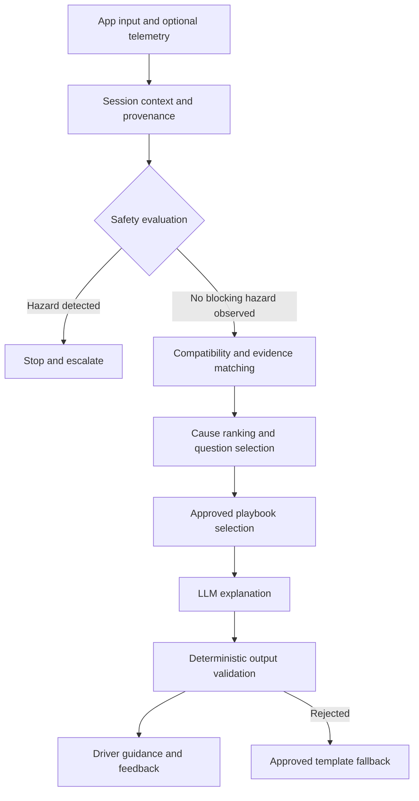

# FuelBuddy AI Charging Diagnostic System

**Technical specification — version 0.2**  
**Date:** 11 October 2026  
**Status:** Proposed implementation baseline; production knowledge requires source verification.  
**Scope:** Evidence-based diagnosis of EV charging failures and unexpectedly slow charging.

## 1. Purpose and principles

FuelBuddy correlates the exact vehicle configuration, charging equipment, operator, session stage, observed errors, and environmental conditions to identify probable causes and select safe next steps.

The same station can work with one vehicle and fail with another. Diagnosis must therefore consider both sides of the vehicle–station interaction, as well as authorization and operator infrastructure.

The system MUST:

- Distinguish observed facts, documented applicability, hypotheses, and unknown information.
- Separate likelihood from severity: a critical defect is not automatically the most likely cause.
- Match vehicle market, variant, equipment, and build range rather than model name alone.
- Treat generic error codes as symptoms unless additional evidence supports a specific cause.
- Produce safe, source-backed actions with explicit escalation criteria.
- Abstain when evidence is insufficient or conflicting.
- Support community contributions through review and provenance, without automatically promoting reports into confirmed defects.

The system supports troubleshooting; it does not certify vehicle safety or replace OEM inspection. It MUST NOT declare a vehicle fault-free solely because a compatibility explanation was found.

### 1.1 Initial scope

The MVP supports manual vehicle selection, station identification, error transcription or image extraction, session-stage questions, and curated playbooks. Vehicle and operator integrations are optional capabilities, not prerequisites.

The initial catalog should cover a small, explicitly supported set of markets, vehicle variants, and station families. Europe and North America require separate connector, recall, and product applicability records.

## 2. Architecture



| Component | Responsibility |
| --- | --- |
| Vehicle provider | Resolve configuration and available telemetry; preserve missing values |
| Station provider | Resolve site, EVSE, connector, hardware, capabilities, and optional live state |
| Context builder | Normalize units, timestamps, identifiers, provenance, and freshness |
| Safety engine | Evaluate approved rules before diagnosis and after every new observation |
| Compatibility engine | Evaluate connector, adapter, voltage, current, protocol, and access constraints |
| Evidence matcher | Retrieve only applicable, approved knowledge and error mappings |
| Ranking engine | Score supporting and contradicting evidence; identify missing discriminators |
| Playbook engine | Select approved actions for the current actor and hazard state |
| LLM | Explain structured findings and phrase approved questions/actions |
| Output validator | Enforce schema, evidence references, action permissions, and safety decisions |
| Review pipeline | Verify sources, adjudicate reports, version knowledge, and support rollback |

The LLM MUST NOT override safety decisions, invent source references, issue station control commands, or generate electrical repair procedures. If the LLM is unavailable, deterministic guidance remains usable.

## 3. Data acquisition and availability

### 3.1 Operating modes

| Mode | Typical available information | Expected limitation |
| --- | --- | --- |
| Manual | Make/model/year/market, connector, display text, symptoms, session stage | Variant, firmware, internal faults, and actual capabilities may remain unknown |
| Public-data assisted | Published station details, OEM specifications, recall campaign applicability | Public listing data is not proof of current station state or VIN recall completion |
| Partner integrated | Consented OEM telemetry, operator events, station capability and session logs | Availability varies by contract, vehicle, station, permission, and timestamp |

OCPP is the station-to-management interface; access to its internal events requires an appropriate operator integration. FuelBuddy MUST NOT assume a mobile app can directly obtain OCPP logs from arbitrary public stations.

### 3.2 Required input envelope

Each observation carries `value`, `unit` where relevant, `source_type`, `source_reference`, `observed_at`, `received_at`, and `quality`. Quality values are `confirmed`, `reported`, `inferred`, or `unknown`.

Missing values MUST remain null/unknown. Zero MUST NOT represent unavailable power, temperature, or state of charge. Conflicting observations are retained and flagged rather than silently overwritten.

### 3.3 Session stages

Normalize stage to one of:

`discovery`, `connected`, `authorization`, `communication_setup`, `parameter_negotiation`, `safety_checks`, `power_delivery`, `charging`, `stopping`, `unknown`.

Record the last successful stage, failure timestamp, raw error text, repeat count, and whether another connector, station, network, or charging mode was tested. This helps distinguish an isolated station failure from a repeatable vehicle symptom.

## 4. Knowledge base schema

Use relational identifiers and join tables for applicability. JSON may preserve raw evidence and optional attributes; it should not replace referential integrity.

### 4.1 Common evidence fields

Every issue, compatibility assertion, error mapping, and playbook MUST reference evidence records.

| Field | Type | Meaning |
| --- | --- | --- |
| evidence_id | UUID | Stable evidence identifier |
| source_type | Enum | OEM, regulator, standard, vendor manual, operator, confirmed service outcome, community report |
| source_url | String | Original document or accessible source location |
| title / publisher | String | Source identity |
| published_at / accessed_at | Timestamp | Publication and retrieval dates |
| document_version / locator | String | Edition, page, section, or campaign identifier |
| market | String | Jurisdiction or product market |
| verification_status | Enum | Unverified, under_review, approved, rejected, superseded |
| reviewed_by / reviewed_at | String / timestamp | Accountable review |
| valid_from / valid_until | Timestamp, nullable | Applicability interval |
| supersedes_id | UUID, nullable | Previous assertion or record |
| permitted_use | String | License or access restrictions |

Only approved knowledge can justify production diagnostic claims. Community reports can inform questions or investigation, with their status displayed internally and never presented as established OEM defects.

### 4.2 Vehicle variants and instances

| Table | Key fields |
| --- | --- |
| vehicle_variants | variant_id, make, model, market, model_year_start/end, build_date_start/end, trim, battery_variant, usable_capacity_kwh, max_dc_kw, max_ac_kw, nominal_voltage_v, dc_input_voltage_min/max_v, supported_protocols |
| vehicle_connectors | variant_id, inlet_type, charge_mode, supported_adapters, restrictions |
| vehicle_conversion_capabilities | variant_id, equipment_code, input_voltage_range, output_limit_kw, equipment_required, verification_method |
| vehicle_instances | vehicle_instance_id, variant_id, protected_vin_reference, equipment_confirmed, software_version, software_observed_at |
| vehicle_issue_applicability | issue_id, variant_id, market, build_range, software_range, equipment_predicates |

VIN decoding is an identification aid. Battery trim, converter fitment, software version, and repair history require separate confirmation when they affect the decision. Software belongs to the vehicle instance, not a static model profile.

### 4.3 Charging infrastructure

| Table | Key fields |
| --- | --- |
| station_sites | site_id, operator_id, network_brand, country, location, support_contact |
| evses | evse_id, site_id, manufacturer, hardware_model, hardware_revision, firmware_version, firmware_observed_at, management_protocol/version |
| connectors | connector_id, evse_id, connector_type, charge_mode, voltage_min/max_v, current_max_a, power_max_kw, adapter_policy |
| station_observations | connector_id, observed_at, operational_state, available_power_kw, power_sharing_state, source, quality |

Rated power and currently available power are separate fields. Unknown hardware or firmware MUST NOT be filled from network-wide assumptions. A station listing identifies a site; connector-level identity is needed for diagnosis.

### 4.4 Known issues and recall campaigns

| Field | Type | Meaning |
| --- | --- | --- |
| issue_id | UUID | Stable issue identifier |
| affected_side | Enum | Vehicle, station, operator, interoperability, user_setup, environment |
| category | Enum | Battery, low_voltage, charging_controller, contactor, thermal, connector, authorization, payment, communication, software, other |
| description | String | Evidence-backed description |
| symptoms | Related records | Normalized symptoms with applicability |
| dtc_codes | Related records | Issuer, ECU, code, version, and confirmed meaning |
| severity | Enum | Critical, high, medium, low |
| support_conditions | Predicates | Observations supporting this hypothesis |
| contradiction_conditions | Predicates | Observations weakening this hypothesis |
| playbook_ids | Relations | Approved resolution procedures |
| evidence_ids | Relations | Supporting sources |

Use `dtc_codes`, correcting the original `dmtc_code` spelling. Do not invent codes when a source does not publish them.

Recall campaigns are separate records: `campaign_id`, `authority`, `market`, `OEM_reference`, `affected_build_range`, `instructions`, `remedy`, and `evidence_ids`.

For an individual vehicle, recall state is `confirmed_open`, `confirmed_completed`, `potentially_applicable`, `not_applicable`, or `unknown`, with verification source and date. Model/year matching alone cannot establish an open VIN-specific recall.

### 4.5 Error mappings

Mapping key:

`namespace + issuer + protocol_version + product_model + firmware_scope + raw_code`.

Fields include raw text, normalized category, session stage, possible causes, safety semantics, evidence references, and approved playbook links.

Keep these namespaces distinct:

- OCPP standard error/status fields, with the exact version and message field.
- OCPP vendor error codes and operator display codes.
- ISO 15118 and DIN SPEC 70121 protocol responses, scoped to edition and charging mode.
- Vendor diagnostic identifiers, including numeric codes published in a charger manual.
- Vehicle DTCs scoped to the OEM/ECU.
- FuelBuddy internal observations and safety rule identifiers.

Correct the original `DIN SPEC 99003` reference to `DIN SPEC 70121`. Do not label Bosch numeric diagnostic identifiers as universal ISO/CCS error numbers. Do not interpret `FAILED_AlignmentError` as a plug seating fault without checking its protocol, charging mode, and vendor documentation.

### 4.6 Compatibility assertions

Fields: `assertion_id`, vehicle variant/configuration predicates, connector/adapter requirements, station capability predicates, protocol/firmware predicates, market, effective dates, evidence_ids, and result.

Results: `compatible`, `compatible_with_limitations`, `documented_incompatible`, `unknown`, `conflicting_evidence`.

An 800V nominal architecture does not alone establish incompatibility with a lower-voltage station. Evaluate vehicle accepted input range, confirmed conversion equipment, station actual voltage range, current limits, adapter approval, and authorization access.

### 4.7 Resolution playbooks

Each playbook contains `playbook_id`, version, actor (`driver`, `operator`, `qualified_technician`), prerequisites, blocking hazards, ordered actions, maximum retries, stop conditions, escalation contact type, evidence_ids, and approval status.

Driver responses MUST exclude operator and technician actions. Station grounding inspection, head assembly removal, opening enclosures, mains isolation, high-voltage repair, and protection bypass are never driver troubleshooting steps.

## 5. Safety policy

Safety is independent of the statistical ranking engine and runs before diagnosis, after new observations, and during final output validation.

| Observation | Required driver-facing behavior |
| --- | --- |
| Smoke, fire, arcing, suspected battery thermal event, or credible burning smell | Stop troubleshooting; move away, keep others clear, and contact local emergency services when fire or immediate danger is suspected; do not touch or attempt to unplug damaged or actively hazardous equipment |
| Confirmed ground/insulation fault or damaged charging equipment | Stop use of the affected equipment; do not retry there; contact operator and follow approved guidance |
| Vehicle high-voltage fault or loss-of-propulsion warning | Follow the applicable OEM warning; halt charging troubleshooting and escalate to roadside assistance or qualified service as appropriate |
| Applicable recall charging restriction | Display the exact approved restriction and applicability status; do not substitute a blanket model-wide instruction |
| Ordinary failed handshake without hazard evidence | Allow only bounded, approved user actions |

A generic error code is not proof of a fire, and a lack of errors is not proof of safety. Weather humidity alone is not evidence of water ingress. Ambient temperature is not battery temperature. Weather-based restrictions require an approved policy and relevant conditions.

Emergency contact numbers are localized and maintained as reviewed configuration. The app does not automatically call services or manipulate a charging session without a separately authorized feature.

## 6. Matching and ranking

### 6.1 Processing sequence

1. Validate inputs and preserve uncertainty.
2. Build the session context and identify the last successful stage.
3. Evaluate safety and vehicle-specific restrictions.
4. Resolve vehicle configuration and connector identity as far as evidence permits.
5. Evaluate physical/electrical/protocol/access compatibility.
6. Retrieve applicable errors and known issues.
7. Generate candidate causes, including ordinary causes and unknown/unmodeled causes.
8. Score supporting evidence, contradiction, specificity, reliability, and freshness.
9. Select the most useful safe clarification question when it can change the next action.
10. Select approved playbooks and escalation paths.
11. Generate and validate the explanation.
12. Capture outcome with its confirmation quality.

### 6.2 MVP ranking

Use a versioned deterministic evidence score for ordering, not a probability. A configurable form is:

`score(cause) = supporting_evidence - contradicting_evidence + applicability_specificity - uncertainty_penalty`.

Weights require documented rationale and validation. Severity determines safety review and escalation priority, not likelihood. Avoid double-counting correlated evidence, such as several reports copied from the same original incident.

Display evidence strength as `strong`, `moderate`, `weak`, or `insufficient`, with reasons and missing information. A named known issue with only model/year applicability remains a hypothesis.

### 6.3 Later probabilistic model

Percentages are allowed only after validation against independently confirmed outcomes, with calibration assessment by supported segment. Maintain an explicit unknown-cause option and abstain for unsupported configurations or distribution shift. Do not force a few retrieved causes to total 100%.

### 6.4 Slow charging analysis

Compare observed power against an expected envelope derived from the existing FuelBuddy charging model:

- AC: vehicle onboard charger capability, supply phases/current, cable limits, station allocation, and charging settings.
- DC: vehicle charging curve at observed SoC, battery temperature/preconditioning, station voltage/current/power constraints, shared power, and session timing.

Declare slow charging only when measurements, units, timestamps, and expected conditions support it. Missing battery temperature or power-sharing data lowers evidence strength. Peak advertised power is not an expected constant charging rate.

## 7. Approved seed data and unresolved claims

This document does not certify a complete vehicle or station issue catalog. The original populated tables MUST NOT be imported as approved production records.

### 7.1 Source-backed examples

| Topic | Revised seed assertion | Applicability limitation |
| --- | --- | --- |
| Hyundai ICCU recall | Hyundai notice 24V-868 / campaign 272 identifies certain 2022–2024 Ioniq 5 and 2023–2025 Ioniq 6 vehicles [S1] | Use the campaign's detailed eligibility and remedy; do not extend this record to Ioniq 9, EV9, Kia, or Genesis by analogy |
| US Mercedes CLA | Mercedes describes up to 320 kW DC charging, NACS DC/J1772 AC, and 400V compatibility dependent on a factory converter available starting spring 2026 [S2] | Verify build, market, variant, and actual converter fitment; older product pages are not evidence that a particular vehicle has the equipment |
| OCPP error classification | OCA distinguishes standard and additional diagnostic reporting, including vendorErrorCode/techCode contexts [S3] | Preserve message field, namespace, and protocol version |

These are narrowly sourced statements, not complete production data records. Review, structured applicability extraction, and current-source checks are still required before activating associated rules.

### 7.2 Claims awaiting verification

| Original claim | Required disposition |
| --- | --- |
| Shared ICCU defect across all listed E-GMP models | Split by OEM, campaign, market, build range, and documented symptoms |
| LEAF 2019–2022 thermal recall and combined Canadian counts | Verify each official campaign separately; distinguish ordinary thermal derating from a recalled defect |
| ID.4 blanket 2023–2025 fire/charging restrictions | Verify each campaign and the exact interim instructions for affected vehicles |
| Bolt port-lock DTCs and charge limits | Verify code meanings, campaign state, and affected configurations |
| Mach-E slow AC charging caused by an OTA | Require the applicable OEM bulletin/software range and supporting session evidence |
| Network-wide EVgo packet loss above 90% | Treat as an unverified report until station/session scope and original evidence are established |
| Universal network hardware and OCPP versions | Replace with actual EVSE-level records or unknown values |
| Bosch numeric error mappings | Verify against the original manual edition before activation |
| Tesla VIN requirement for all non-Tesla sessions | Replace with market/site/vehicle/adapter/access eligibility predicates |

No unverified item may trigger a definitive diagnosis or repair recommendation.

## 8. Diagnostic examples

### A. Ioniq 5 with a communication error

**Observed:** 2023 Ioniq 5 at an identified DC connector; station reports `EVCommunicationError`; no DTC or low-voltage measurement available.

**Result:** Communication failure is observed. Station-side communication, connection, authorization sequencing, and vehicle-side communication remain possible. ICCU campaign applicability can be checked separately, but the generic station error does not establish ICCU failure.

**Guidance:** Check for vehicle warnings; follow a bounded approved retry procedure if no blocking hazard exists. A successful session at another station weakens some vehicle-fault hypotheses. Repeated failure across independent stations supports vehicle service investigation but still does not confirm a specific component.

### B. CLA at a lower-voltage DC station

**Observed:** Market and variant resolved; converter fitment unknown; station output capability confirmed.

**Result:** Compatibility is unknown pending equipment confirmation. If authoritative configuration evidence confirms absence of required conversion equipment and electrical ranges are incompatible, return documented incompatibility for that pairing.

**Guidance:** Confirm converter equipment or use a verified compatible station. Do not state that the vehicle has no fault.

### C. Mach-E charging slowly on AC

**Observed:** AC session is active; delivered power is below user expectation; station allocation and vehicle settings unknown.

**Result:** Insufficient evidence for a software regression. First compare supply phases/current, station power sharing, cable rating, vehicle AC capability, and configured current/schedule.

**Guidance:** Ask for displayed kW and current limit, then evaluate the expected AC envelope. Retrieve an OEM software issue only if its applicability is verified. Do not recommend switching to DC as a universal workaround for a suspected vehicle fault.

## 9. LLM contract

### 9.1 Structured input

```json
{
  "session_id": "example-session",
  "knowledge_version": "example-kb-version",
  "safety": {
    "state": "no_blocking_hazard_observed",
    "allowed_action_ids": ["ASK_WARNINGS", "CONTACT_OPERATOR"]
  },
  "vehicle": {
    "make": "Hyundai",
    "model": "Ioniq 5",
    "model_year": 2023,
    "market": "US",
    "variant_confirmed": false,
    "recall_status": "unknown"
  },
  "station": {
    "connector_id": "example-connector",
    "firmware_version": null
  },
  "observations": [
    {
      "namespace": "OCPP",
      "protocol_version": "1.6",
      "raw_code": "EVCommunicationError",
      "source_type": "operator_integration",
      "quality": "reported"
    }
  ],
  "compatibility": {"status": "unknown"},
  "candidates": [
    {
      "cause_id": "communication_failure_unlocalized",
      "evidence_strength": "insufficient",
      "supporting_observation_ids": [],
      "contradictions": [],
      "missing_information": ["vehicle warnings", "failure stage"]
    }
  ],
  "approved_actions": [
    {"action_id": "ASK_WARNINGS", "text": "Does the vehicle show any warning message?"},
    {"action_id": "CONTACT_OPERATOR", "text": "Contact the station operator with the connector ID and displayed error."}
  ]
}
```

Illustrative identifiers are not real records. Production observations MUST include timestamps and source references as specified in Section 3.

### 9.2 Structured output

Required fields:

`summary`, `safety_state`, `ranked_causes`, `evidence_strength`, `supporting_evidence_ids`, `missing_information`, `clarifying_questions`, `action_ids`, `escalation`, `limitations`.

The output MUST use supplied candidate and action identifiers. The validator rejects unsupported facts, unauthorized actions, invented probabilities, contradictory safety language, and claims of confirmed repair or recall coverage absent evidence.

If validation fails, return approved template guidance. Source text, user uploads, community comments, and station messages are untrusted content: they cannot change system rules or action permissions.

## 10. Interface and privacy

The app presents the next safe action first, then a short explanation, evidence strength, and optional details. It must support manual correction of vehicle/station identity, photo transcription confirmation, and clear operator versus dealer escalation.

Use SI units internally: kW, kWh, volts, amperes, and degrees Celsius. Convert display units per user preference. Distinguish instantaneous power, energy delivered, and averaged power.

Collect only information needed for the diagnostic session. VIN, precise location, vehicle identifiers, account state, and session telemetry require explicit purpose and appropriate consent. Use pseudonymous vehicle/session identifiers in analytics; encrypt sensitive records and separate credentials from diagnostic data.

Do not send full VIN, payment credentials, access tokens, or unnecessary personal location history to the LLM. Consent to diagnosis is separate from consent to community publication or model-training use. Publish only reviewed and de-identified contributions. Define retention, deletion, export, and access-control policies before launch.

The diagnostic MVP is read-only with respect to vehicle and station controls. Any future remote-control feature requires a separate specification, authorization model, and safety assessment.

## 11. APIs and implementation requirements

Proposed service endpoints:

| Endpoint | Purpose |
| --- | --- |
| `POST /v1/diagnostic-sessions` | Create a session with available vehicle/station context |
| `POST /v1/diagnostic-sessions/{id}/observations` | Append immutable observations and trigger reevaluation |
| `POST /v1/diagnostic-sessions/{id}/evaluate` | Return versioned safety, compatibility, ranking, and actions |
| `POST /v1/diagnostic-sessions/{id}/outcomes` | Record user or independently verified outcome |
| `GET /v1/diagnostic-sessions/{id}` | Retrieve authorized session state |

Mutations require authentication, authorization, schema validation, and idempotency handling. Each evaluation records input references, rule version, knowledge version, ranking version, model version when used, and selected actions.

External integrations need timeouts, rate limits, freshness policies, and circuit breakers. On failure, fall back to manual inputs and disclose unavailable evidence. Cached public specifications must not be represented as live telemetry.

A resolved session is not automatically a confirmed root cause. Store outcomes such as `charged_after_retry`, `charged_at_other_station`, `operator_confirmed_station_fault`, `dealer_confirmed_component_fault`, and `unresolved`, with supporting evidence and actor.

## 12. Validation and release gates

| Test group | Required checks |
| --- | --- |
| Safety | Blocking hazards suppress retries and ordinary troubleshooting; restrictions persist across LLM and fallback paths |
| Applicability | Market, variant, build range, software, adapter, and converter conditions are respected |
| Error scope | Identical numeric codes from different issuers cannot collide; unknown firmware does not create a precise match |
| Ranking | Severity is not treated as likelihood; contradictory evidence lowers support; unknown causes remain possible |
| Missing data | Null telemetry does not become zero; unknown converter/firmware/recall status produces uncertainty |
| Slow charging | SoC, AC/DC mode, capability limits, timing, and available temperature data affect expected power correctly |
| LLM | Prompt injection, invented sources/probabilities, unauthorized actions, and definitive unsupported diagnoses are rejected |
| Privacy | Sensitive identifiers and credentials are excluded from LLM payloads and public contributions |
| Offline/failure | Approved deterministic guidance remains available when providers or the LLM fail |

Release requires complete passing results for the curated safety cases, source-backed approval of every active playbook, and no unsupported action in the adversarial validation suite. These gates apply to the tested scope; they do not prove universal safety.

Measure diagnostic coverage, abstention rate, confirmed-outcome accuracy, top-k recall, user-action success, incorrect escalation, and unsafe-action violations. Evaluate calibration before releasing probabilities. Segment results by market, vehicle, station family, charging mode, and data availability. Define target latency and accuracy using pilot evidence rather than unsupported promises.

## 13. Delivery roadmap

Timelines are indicative and depend on access to sources and partner APIs.

| Phase | Indicative timing | Deliverable and exit condition |
| --- | --- | --- |
| Evidence foundation | Weeks 1–4 | Normalized schema, source review workflow, narrow approved catalog, safety playbooks |
| Manual diagnostic MVP | Weeks 5–8 | Session stages, identity resolution, compatibility rules, deterministic ranking; missing-data and safety checks pass |
| LLM explanations | Weeks 9–12 | Structured contract, output validation, injection testing, deterministic fallback |
| App pilot | Weeks 13–16 | Manual/photo input, localized guidance, consent, support escalation, measured user outcomes |
| Partner integrations | After validated access | One OEM/operator integration at a time with capability and freshness contracts |
| Continuous improvement | Ongoing | Reviewed contributions, confirmed outcome labels, versioned releases, rollback, later calibrated ranking |

No automatic retraining or rule promotion follows a single successful retry. Human review and regression validation precede knowledge and model releases.

## 14. Source maintenance and collaboration

| Source class | Use | Update approach |
| --- | --- | --- |
| Regulatory recalls | Campaign applicability and official restrictions | Scheduled ingestion and change review; freshness disclosed |
| OEM manuals/bulletins | Configuration, warning meanings, approved procedures | Versioned ingestion when accessible and permitted |
| Standards and vendor manuals | Protocol semantics and product-specific mappings | Edition and firmware-aware review |
| Operator integrations | Current connector/session evidence | Contract-defined event or polling cadence |
| Public status/listing data | Context and discovery | Provider-defined freshness; no assumption of internal diagnostics |
| Community reports | Leads, recurring patterns, usability feedback | Consent, moderation, deduplication, and corroboration |
| FuelBuddy outcomes | Evaluation and candidate knowledge | Preserve confirmation quality and independent evidence |

API access, licensing, and reuse rights for PlugShare, ABRP, OEM services, and operator feeds must be established before ingestion. Public visibility does not imply unrestricted API or bulk reuse access. Neither NHTSA nor other external sources should be described as guaranteed real-time feeds without an actual service contract.

FuelBuddy is intended to be community driven. OEMs, charging operators, equipment vendors, researchers, and drivers are welcome to collaborate throughout implementation, particularly on verified interoperability cases, diagnostic access, safe playbooks, and outcome validation.

## 15. References and verification boundary

The following primary sources support the narrow corrections in this revision. Other original vehicle/recall/error claims remain unverified as identified in Section 7.

- **[S1] Hyundai Motor America:** Recall 24V-868 / campaign 272 owner notice. https://static.nhtsa.gov/odi/rcl/2024/RCONL-24V868-8658.pdf
- **[S2] Mercedes-Benz USA:** 2026 CLA specification and converter applicability. https://www.mbusa.com/en/future-vehicles/2026-mercedes-benz-cla-sedan
- **[S3] Open Charge Alliance:** Improving Uptime Monitoring with OCPP. https://openchargealliance.org/wp-content/uploads/2024/08/improving_uptime_with_ocpp_v1_2.pdf
- **[S4] Open Charge Alliance:** OCPP protocol overview and available versions. https://openchargealliance.org/protocols/ocpp-protocols/
- **[S5] NHTSA:** Recall, investigation, manufacturer communication, and VIN lookup resources. https://www.nhtsa.gov/resources-investigations-recalls

Sources were consulted during the review accompanying this revision. Production ingestion must retain exact document editions, source locators, applicability, retrieval dates, and review decisions. Product pages can change; snapshot or version the relied-upon evidence where permitted.

## 16. Changes from the original draft

- Replaced unsupported diagnostic percentages with evidence strength and a calibration requirement.
- Moved safety checks ahead of diagnosis and added final output enforcement.
- Separated vehicle variants, instances, recall campaigns, and VIN-specific recall state.
- Replaced nominal voltage matching with electrical capabilities and equipment-aware compatibility.
- Corrected the narrowly verified CLA and Hyundai campaign examples.
- Removed unsupported model/network-wide defect assertions from approved seed data.
- Separated standard protocol semantics, vendor error identifiers, and vehicle DTCs.
- Restricted driver guidance to approved actions and removed station repair instructions.
- Added data availability modes, missing-data behavior, provenance, privacy, evaluation, and community review.
- Preserved the core objective: identify charging failures through the combined vehicle–station–operator context.
